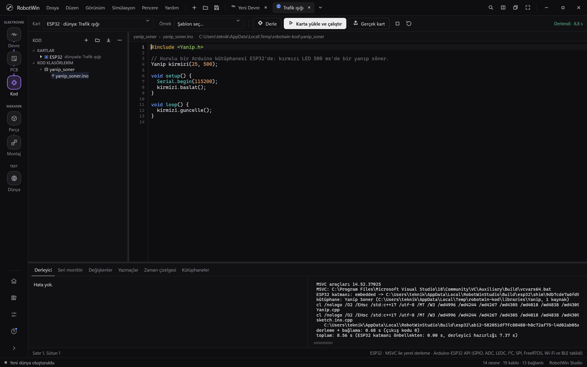
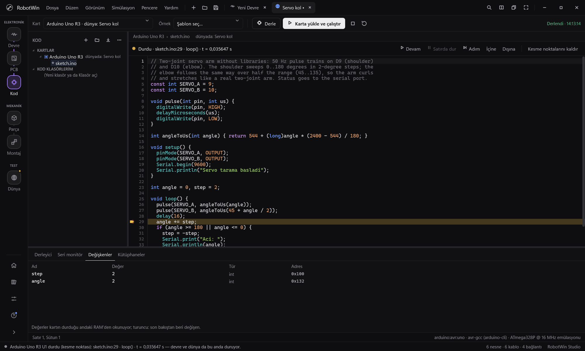

# 4. Kod

**Kod** sayfası (Ctrl+3), kartların yazılımını yazdığınız yerdir. Sayfa bir kod editörü gibi çalışır:

- solda klasörler ve dosyalar;
- ortada tamamlama ve imza yardımı olan editör;
- altta derleyici, seri monitör ve Arduino kütüphaneleri.

Yazdığınız kodu projedeki ya da açık dünyadaki **herhangi bir karta** (Arduino Uno, Arduino Nano, ESP32) yükleyip çalıştırabilirsiniz.


## Başlamadan önce

- Arduino kodu derlemek için `arduino-cli` kurulu olmalıdır:

  ```text
  winget install ArduinoSA.CLI
  arduino-cli core install arduino:avr
  ```

- ESP32 kodu derlemek için Visual Studio C++ araçları (MSVC) kurulu olmalıdır.

Ayrıntılar: [1. Başlarken](01-baslarken.md#kendi-kodunuzu-derlemek-için-isteğe-bağlı).

## Gezgin: kartlar ve kod klasörleri

Sol taraftaki gezginde iki bölüm vardır:

- **KARTLAR:** projedeki ve açık dünyadaki her programlanabilir kart. Her kartın kodu kendi klasöründe, projenin (ya da dünyanın) içinde saklanır.
- **KOD KLASÖRLERİM:** diskteki klasörler. Yeni klasörler `Belgeler\RobotWin\Kod` içinde açılır. Diskten açtığınız her klasör de burada listelenir (ör. Arduino IDE'nin bir çizim klasörü).

Gezginin üstündeki düğmeler:

| Düğme | Ne yapar |
| --- | --- |
| Yeni dosya | Seçili klasöre `.ino`, `.h`, `.cpp` … ekler |
| Yeni kod klasörü | Diskte yeni bir çizim klasörü açar |
| Klasör aç | Diskteki herhangi bir kod klasörünü listeye ekler |
| ⋯ | İçe aktar, diske kaydet, zip, yeniden adlandır, sil |

Bir klasöre ya da dosyaya sağ tıklayınca şunlar gelir:

- **Yeni dosya…**, **Yeni klasör…**: dosya ya da alt klasör ekler, ör. `src/`.
- **Dosya içe aktar…**, **Klasör içe aktar…**: başka yerden dosya ya da klasör kopyalar. Dosyaları Explorer'dan gezgine sürükleyip bırakmak da olur.
- **Karta yükle:** klasörü seçtiğiniz karta yükler.
- **Diske kaydet (Arduino çizim klasörü olarak)…**: istediğiniz yere kaydeder.
- **Zip olarak dışa aktar…**
- **Klasörü Explorer'da göster**, **Yeniden adlandır**, **Sil**.
- **Listeden kaldır (diskte kalır):** klasörü yalnızca listeden çıkarır.

Diskteki dosyalarda **Ctrl+S** kaydeder.

### Çok dosyalı çizimler

Bir çizim birden çok dosyadan oluşabilir: ana `.ino`, yanında `.h` / `.cpp` dosyaları ve `src/` altındaki alt klasörler. Arduino IDE'deki gibi hepsi birlikte derlenir. Bu hem Uno / Nano'da hem ESP32'de geçerlidir. Bir kartın klasörüne eklediğiniz dosyalar proje dosyasında saklanır.

## Adım adım: ilk kodunuz

1. Gezginde bir kart ya da kod klasörü seçin.
2. Klasör boşsa **Örnek** listesinden bir şablon seçin, örneğin **Blink (D13 LED)**.
3. **Kart** listesinden kodun yükleneceği kartı seçin. Listede projedeki ve açık dünyadaki her Uno, Nano ve ESP32 vardır.
4. **Derle** düğmesine veya **F7**'ye basın. Alttaki **Derleyici** sekmesinde çıktı görünür. Hatalar Türkçe açıklanır; hatanın olduğu dosya açılır ve satır işaretlenir.
5. **Karta yükle ve çalıştır** düğmesine veya **F5**'e basın. Klasördeki kod karta kopyalanır, derlenir ve simülasyon başlar. Kart dünyadaysa dünya çalışmaya başlar.
6. **Seri monitör** sekmesinde `Serial.print` çıktısını görün. Alttaki kutuya yazıp **Gönder** ile karta veri yollayın.

Gezgin ve alttaki sekmeler (Derleyici, Seri monitör, Değişkenler, Yazmaçlar, Zaman çizelgesi, Kütüphaneler) öbür sayfalardaki paneller gibidir: başlığından ya da sekmesinden sürüklenip öbür yana, alta ya da ayrı pencereye (ikinci ekrana da) alınır, şeride küçültülür ya da gizlenir; yerleşim saklanır ve çalışma alanlarına girer. Alt bölme açılışta kapalıdır; bir sekmeye tıklamak ya da derlemek onu açar.

Araç çubuğundaki diğer düğmeler simülasyonu durdurur ve kartı resetler.

Her derleme, kartın kodunda neyle derlendiğini projeye yazar: derleyici ve kart çekirdeğinin sürümü, örneğin `arduino-cli 1.6.0 · arduino:avr 1.8.8` (derleme durumunun üstüne gelince görünür). Proje başka bir bilgisayarda ya da güncellenmiş bir derleyiciyle derlenirse **Derleyici** sekmesi önce bunu söyler: aynı kod başka bir avr-gcc ile farklı bir ikili verebilir.

## Kod tamamlama ve imza yardımı

Editör, kartın gerçek başlık dosyalarını okur:

- Uno / Nano için Arduino AVR çekirdeğini, kurulu kütüphaneleri ve çizim klasörünü;
- ESP32 için simülasyon katmanını.


Tamamlama listesi şu durumlarda açılır:

- `.`, `->` ve `::` yazınca (ör. `Serial.` → `print`, `println`, `begin` …);
- `#include <` yazınca (kullanılabilir başlıklar);
- **Ctrl+Space** ile her yerde.

Liste sizin fonksiyonlarınızı, değişkenlerinizi ve `#define`'larınızı da bilir. Bir değişkenin türünü bildiği için `kol.` yazınca `Servo` sınıfının üyelerini gösterir.

Kullanım:

- **↑ ↓** ile seçin; **Enter** ya da **Tab** ile ekleyin; **Esc** kapatır.
- Sağdaki panel seçilen öğenin imzasını ve kısa açıklamasını gösterir.
- Parantez açınca fonksiyonun parametreleri satırın üstünde görünür ve yazdığınız parametre kalın olur. Kaybolursa **Ctrl+Shift+Space** geri getirir.

**Pinden parçaya:** imleç bir pinin üstündeyken (`digitalWrite(9, …)` gibi bir pin çağrısına verilen sayı ya da `#define LED 13`, `const int TRIG = 9;` gibi bir pin çağrısında kullanılan ad, tanımında da kullanıldığı yerde de) alttaki satır kartın pinini ve neye bağlı olduğunu yazar: "IO25 → R1". O parça devrede, PCB'de ve Montajda da seçilir (görünümler yerinde kalır; Ayarlar → Dünya ve düzenleme → Ortak seçim). Pin çağrısına hiç verilmeyen bir değişken (`int hiz = 9;`) pin sayılmaz.

## Arduino kütüphaneleri

Alttaki **Kütüphaneler** sekmesi Arduino kütüphane listesinde arama yapar. Liste yaklaşık 10 000 kütüphane içerir ve bilgisayardaki `arduino-cli` listesinden okunur.

- Arama kutusuna ad ya da başlık yazın, ör. `servo`, `lcd i2c`, `dht`, `Servo.h`.
- **Kur ve ekle** düğmesi kütüphaneyi `arduino-cli lib install` ile indirir, kurar ve koda `#include` satırını ekler.
- Kurulu bir kütüphanenin başlık düğmeleri (ör. `Servo.h`) `#include` satırını ekler; **Kütüphaneyi kaldır** kütüphaneyi siler.
- Liste hiç indirilmemişse **Kütüphane listesini indir** düğmesi `arduino-cli lib update-index` çalıştırır.
- Kodda kurulu olmayan bir başlık varsa (ör. `#include <Servo.h>`) uyarı çıkar. Sekme o başlığı sağlayan kütüphaneyi gösterir.

ESP32 kartlarında da kurulu Arduino kütüphaneleri kullanılır:
- Çizim bir kütüphanenin başlığını içerince (`#include <AccelStepper.h>`) o kütüphane bulunur ve çizimle birlikte simülasyon katmanına derlenir. Kütüphanenin kendi bağımlılıkları da bulunur.
- Simülasyon katmanının kendi başlıkları (`Wire.h`, `Servo.h`, `WiFi.h` …) önceliklidir.
- Kütüphane değişince ya da güncellenince çizim yeniden derlenir.
- Adreslenebilir LED şeritleri (WS2812B / NeoPixel) iki modda da çalışır: `rgbLedWrite`, RMT işlevleri (`rmtInit`, `rmtWrite`) ve `Adafruit_NeoPixel` sınıfı. `Adafruit_NeoPixel.h`, RobotWin'in RMT üzerine yazılmış kendi sürümüdür; gerçek kart derlemesi de onu kullanır, kurulu Adafruit kütüphanesi varsa o tercih edilir. Kartın GPIO'suna DIN'i bağlı şeritteki LED'ler gönderilen renkleri alır ve renklerine göre akım çeker.
  - Veri seviyesi denetlenir. 5 V'luk şerit veri sayfasında VIH = 0,7·VDD (3,5 V) ister; ESP32'nin 3,3 V'u bunun altındadır. Çoğu şeritte çalıştığı için şerit yine yanar, ama olay günlüğü bir kez uyarır (seviye dönüştürücü 74AHCT125 ya da ilk LED'i bir diyotla ~4,3 V'tan besleme önerilir). Şeridin beslemesinin yarısının altındaki veriyi şerit hiç okumaz. Zincirdeki sonraki şeritler veriyi bir önceki şeridin kendi beslemesinden alır.
  - Uno / Nano'da da çalışır: Adafruit_NeoPixel'in (ya da kendi yazdığınız) çevrim sayımlı bit-bang döngüsünün pindeki her kenarı emülatörde tam çevriminde oluşur. Şerit bu kenarları gerçek WS2812B gibi okur: 0,5 µs'den kısa yüksek darbe 0, uzunu 1; 50 µs'den uzun düşük seviye kareyi mandallar. Zamanlaması bozuk darbede kare düşer.
- Döner enkoderler ESP32'nin darbe sayıcısıyla (PCNT) iki modda da sayılır: ESP-IDF'nin `driver/pulse_cnt.h`'i (birim, kanal, kenar ve seviye eylemleri, sınırlar, izleme noktaları). Enkoderli motorun C1/C2 çıkışlarını iki GPIO'ya bağlayın; ×4 çözümle sayım devredeki enkoderle kenarı kenarına aynıdır. `ESP_ERROR_CHECK` başarısız bir çağrıda yongadaki gibi hatayı yazar ve kartı yeniden başlatır.
  - Aksaklık süzgeci (`pcnt_unit_set_glitch_filter`, en çok 12,8 µs) hızlı modda donanımdaki gibi çalışır. Yeni seviye ancak süzgecin genişliği kadar sürdüyse sayılır, ondan kısa darbe hiç sayılmaz.
  - Kartın kendi sürdüğü bir pindeki PWM (LEDC ya da MCPWM) aynı pindeki darbe sayıcıyla sayılır, gerçek yongada GPIO matrisinin yaptığı gibi. Frekans ya da görev oranı değişince sayım yeni zamanlamayla sürer.
- Motor sürmek için ESP32'nin MCPWM'i iki modda da çalışır: ESP-IDF'nin `driver/mcpwm_prelude.h`'i (zamanlayıcı, operatör, karşılaştırıcı, üreteç, ölü zaman). Yarım köprünün iki pini tümleyen PWM'i ölü zamanıyla alır.
- `ledcWrite` (servo ve ESC yazımları dahil) yongadaki gibi, kanalın önceki görev güncellemesi PWM periyodunun sonunda oturana dek bekler. 50 Hz bir servoyu 20 ms'den sık yazan döngü 50 Hz'e düşer; hızlı bir kontrol döngüsünde servoyu yalnızca 20 ms'de bir yazın.
- Uyku modları iki modda da çalışır. `esp_deep_sleep_start()` kartı kapatır; zamanlayıcı ya da EXT0 uyandırınca yeniden açılır, `RTC_DATA_ATTR` değişkenleri korunur. `esp_light_sleep_start()` zamanlayıcı, EXT0 ya da `gpio_wakeup_enable` ile seçilen pin seviyesi gelene dek uyur, sonra kaldığı yerden sürer: `esp_sleep_get_wakeup_cause()` nedeni verir, `millis()` uyunan süre kadar ilerler. Uykuda kart az akım çeker (derin uykuda 10 µA, hafif uykuda 0,8 mA), pil ömrü hesabı gerçekçi olur.
- ESP32'nin yazmaçlarına doğrudan erişen başka kütüphaneler simülasyon katmanında bulunmayabilir. O zaman hata hangi kütüphanenin derlenemediğini söyler.



## Arduino şablonları

| Şablon | Ne yapar |
| --- | --- |
| Blink (D13 LED) | D13'teki LED'i saniyede bir yakıp söndürür |
| PWM ile parlaklık (D9) | D9'daki LED veya motorun gücünü yavaşça artırıp azaltır |
| Buton ile LED | D2'deki buton basılıyken D13'teki LED yanar |
| Analog okuma + seri | A0'daki gerilimi okuyup seri monitöre yazar |
| HC-SR04 mesafe | Ultrasonik sensörle mesafeyi cm olarak yazar |
| Engelden kaçan robot | HC-SR04 ve iki motorla engelden kaçar |
| Çizgi izleyen (2 sensör) | İki TCRT5000 ile çizgi izler |
| I²C tarayıcı | I²C veri yolundaki cihazların adreslerini bulur |
| MPU-6050 ivme | İvme ve jiroskop değerlerini okur |

ESP32 kartları için yeni kod, GPIO2'deki LED'i yakıp söndüren bir ESP32 Blink ile başlar.

## Arduino nasıl çalışır?

Kodunuz gerçek `avr-gcc` ile (`arduino-cli` üzerinden) derlenir. Ortaya çıkan HEX dosyası, çevrim doğruluğunda çalışan bir **ATmega328P emülatöründe** devreyle birlikte adım adım çalışır. Desteklenenler:

- Tüm komut seti ve kesmeler
- Dijital pinler, harici kesmeler ve pin değişim kesmeleri
- Timer0/1/2 ve PWM (`analogWrite`)
- Seri port (USART), ADC (`analogRead` devredeki gerçek gerilimi okur), EEPROM, watchdog
- I²C (TWI); SSD1306 OLED, PCF8574 + HD44780 LCD ve MPU-6050 modülleri gerçekten cevap verir
- SPI (ana kip): `SPI.transfer` baytı ayarlanan hız ve kipte D13 (SCK) ve D11'den (MOSI) bit bit çıkarır, D12'den (MISO) okur; CS'i herhangi bir pine bağlı MCP3008 ve BMP280 devrede cevap verir

> İpucu: Arduino IDE'de derlediğiniz bir `.hex` dosyanız varsa, **Devre** sayfasındaki **Kart pinleri** sekmesinde **HEX yükle…** ile doğrudan yükleyebilirsiniz.

Program ile devre tek bir saatle ilerler. Uno, her zaman diliminin sonuna ait çevrime kadar çalışır; bir önceki dilimden taşan komut bir sonrakinden düşülür. Bu yüzden `millis()` ile devrenin zamanı arasında kayma birikmez: bir saniyenin sonunda program tam 16 000 000 çevrimdedir.

### Arduino uyumluluğu

Arduino işlevleri ve AVR çekirdeğiyle gelen kütüphaneler gerçek bir çizimle denenir (`CoreSim/tests/RobotTwin.CoreSim.Tests/Fixtures/arduino-compat.ino`, `avr-gcc` ile derlenmiş). Çizime seri porttan bir harf gönderilir, girişleri belli anlarda sürülür; sonuç çizimin yazdığından ve yonganın kendi pin kaydından (zaman çizelgesinin gördüğü) okunur. Tablo bu testlerin sonucudur (`ArduinoCompatTests`).

| İşlev / kütüphane | Ne denendi | Sonuç |
| --- | --- | --- |
| `tone(8, 1000)` | D8'deki frekans, 60 ms boyunca | 1000,1 Hz, 61 periyot |
| `SoftwareSerial` (9600) | D11'den "Merhaba" gönderir, D10'a verilen "Selam"ı okur | D11'den çözülen "Merhaba", okunan "Selam" |
| `pulseIn(7, HIGH)` | D7'ye 1234 µs'lik darbe | 1229 µs (kütüphane süreyi döngü sayısından hesaplar) |
| `attachInterrupt(…, FALLING)` | D2'ye 25 düşen kenar | 25 |
| `analogWrite` | D3, D5, D6, D9, D10, D11 | D5 ve D6 976,6 Hz, diğerleri 490,2 Hz; görev oranı değere göre |
| `micros()`, `delay(10)` | gecikmenin süresi | 10 012 µs |
| `delayMicroseconds(250)` | D12'de iki gecikmeli kare dalga | 509,7 µs periyot (`digitalWrite`'ın süresi dahil) |
| `EEPROM.put` / `get` | `float`, `long`, `char[8]` yapısı | aynen geri okunur |
| `Wire` | 1–126 adres taraması | boş veriyolunda 0; MPU-6050 ve BMP280 ile 2 |
| `SPI` | MCP3008'in CH0'ı (CS D10, 1 MHz, kip 0) | 1,25 V'ta 256; 24 saat darbesi, MOSI'de 01 80 00; devredeki Uno'nun 3,3 V'u 676 |
| `Serial.parseInt`, `readStringUntil` | "123 abc" ve satır sonu | 246 ve " abc" |
| `INPUT_PULLUP`, `analogRead(A0)` | A0'da 2,5 V | 512 |

## Hata ayıklama: kesme noktası, adım, değişkenler

Arduino Uno ve Nano kodunu satır satır izleyebilirsiniz. Kart bir kesme noktasına geldiğinde çalıştığı yer de aynı anda durur: **Devre** sayfasındaki simülasyon ya da **Dünya**. Böylece kodu, devredeki gerilimleri ve akımları, kabloları ve dünyadaki parçaları aynı anda, aynı simüle edilmiş zamanda görürsünüz.

1. Kartın kodunu açın ve durmak istediğiniz satırın numarasına tıklayın. Satırda kırmızı bir nokta belirir. Kodu olmayan bir satıra (yorum, boş satır, değişken bildirimi) konan nokta, kodu olan bir sonraki satırda durur. Hiç durulamayacak bir satırdaki nokta içi boş bir halka olarak görünür.
2. **Karta yükle ve çalıştır** (F5) ile kodu derleyip yükleyin. Satır bilgisi derlemeyle birlikte gelir: kesme noktaları yalnız burada derlenmiş yazılımda çalışır.
3. Kart o satıra gelince durur:
   - satırda sarı bir ok ve bant belirir;
   - üstteki çubukta yer, fonksiyon ve simüle edilmiş zaman yazar;
   - **Değişkenler** sekmesi kodunuzdaki global ve `static` değişkenleri o anki değerleriyle gösterir;
   - **Yazmaçlar** sekmesi ATmega328P'nin kendisini gösterir:
     - solda çekirdek: PC, SP, SREG'in bayrakları (`I-----Z-`), X/Y/Z işaretçileri, R0–R31, çevrim sayısı;
     - sağda çevre birimlerinin yazmaçları adlarıyla, gruplarına göre (portlar, zamanlayıcılar, kesmeler, ADC, USART, SPI, TWI, EEPROM): değer, ikili hali, adres ve açık olan bitlerin adları (`UCSR0A`'da `RXC0 UDRE0` gibi). 16 bitlik çiftlerin (TCNT1, OCR1A, UBRR0, ADC, SP) değeri tek sayı olarak yazılır;
     - son bakıştan beri değişen değerler turuncudur: bir adımın donanıma ne yaptığı bir bakışta görünür;
     - bakmak donanımı etkilemez: gerçek okuma UDR0'daki baytı alır, TCNT1'in yüksek baytını kilitler, SPIF'i siler; buradaki okuma hiçbirini yapmaz;
   - **Zaman çizelgesi** sekmesi yongaya takılmış bir mantık analizörüdür:
     - program ilk komutundan beri her pinin seviye değişimini (çıkışları programın yazdığı, girişleri devrenin sürdüğü anda) ve her kesmenin girişini ve `RETI`'sini çevrim çevrim kaydeder;
     - değişen ya da çıkış olan her pin bir iz, servis edilen her kesme (`TIMER0_OVF`, `USART_UDRE`, `INT0`…) bir satır: işleyicinin çalıştığı süre bir çubuk;
     - sağ sütun ölçer: pinin son tam periyodu ve yüksek kaldığı süre (`56.6 Hz · yüksek 1.03 ms`), kesmenin sayısı ve en uzun çalışması (`19× · en uzun 5.9 µs`);
     - tekerlek imlecin altındaki anı sabit tutarak yakınlaştırır, sürükleme geri kaydırır, çift tık şimdiye döner; imlecin zamanı üstte yazar;
     - osiloskopla tek zaman ekseni: **Osiloskopla eşle** zaman çizelgesini devredeki osiloskobun gösterdiği saniyelere getirir; birinde gezdiğiniz an öbüründe kesikli vurgu çizgisiyle işaretlenir (zaman çizelgesinde pencerenin dışındaysa kenarda bir ok o yönü gösterir);
     - zamanlayıcının kendisinin sürdüğü PWM pinleri kenar olarak görünmez (donanım onları program yazmadan çevirir): satırları o anki frekans ve doluluğu yazar. TWI açıkken A4/A5 bayt bayt izlenmez.
4. Buradan devam edin:

| Düğme | Kısayol | Ne yapar |
| --- | --- | --- |
| **Devam** | F5 | Programı, devreyi ve dünyayı bir sonraki kesme noktasına kadar sürdürür |
| **Adım** | F10 | Bir sonraki satıra geçer; çağrılan fonksiyonlar (örneğin `delay`) durmadan çalışır |
| **İçine** | F11 | Çağrılan fonksiyonun içine, kodunuzdaki ilk satırına girer |
| **Dışına** | Shift+F11 | İçinde bulunulan fonksiyon dönene kadar çalışır |
| **Satırda dur** | — | Çalışan programı kodunuzun bir sonraki satırında durdurur |

Değerler kart çalışırken de yenilenir. Son bakıştan beri değişen değer turuncu görünür. Duran bir dünyayı **Dünya** sayfasındaki **Devam** düğmesiyle de sürdürebilirsiniz.



> `-Os` ile derlenen kodda derleyici bazı satırları birleştirir ya da başka satırların içine gömer. Bu yüzden adımlar bazen beklediğinizden farklı bir sırayla ilerler. Arduino IDE'nin hata ayıklayıcısında da durum aynıdır.

ESP32 çizimleri bilgisayarın işlemcisinde yerel olarak çalıştığı için kesme noktaları şimdilik yalnız Arduino Uno / Nano (ATmega328P) içindir.

## ESP32 nasıl çalışır?

ESP32 kodu (çizim) bilgisayarınızda MSVC ile yerel olarak derlenir ve devreyle eş zamanlı çalışır. İlk derleme biraz uzun sürer, çünkü ESP32 donanım katmanı da kurulur; sonraki derlemeler önbellekten hızlı gelir.

Desteklenenler:

- `pinMode`, `digitalRead/Write`, `attachInterrupt`
- `analogRead` (zayıflatma ve çözünürlük ayarlarıyla), `analogWrite`, `ledc*` PWM, `dacWrite`, `touchRead`, `tone`, `pulseIn`
- Donanım zamanlayıcıları, `millis`, `micros`, gecikmeler
- FreeRTOS görevleri, kuyruklar, semaforlar
- `Serial`, `Wire` (I²C), `EEPROM`, `Servo` / `ESP32Servo`
- `WiFi` (dünya içinde sanal ağ; İnternet yok), BLE (temel özellikler), **Bluepad32** (PS5, PS4, Xbox kumandaları)
- **ESP-NOW** (`esp_now.h`): kartlar arasında yönlendiricisiz kısa mesajlar (en çok 250 bayt). Gerçek sürücüdeki gibi önce `WiFi.mode(WIFI_STA)`, sonra `esp_now_init()`; tek adrese gönderim yalnız `esp_now_add_peer` ile eklenen eşe yapılır (yayın adresi FF:FF:FF:FF:FF:FF de eş olarak eklenir). Çerçeveler dünyanın radyo ortamında mesafe, duvar ve sönümlenmeyle iletilir. Tek adrese gönderim alındı onayı beklenip 7 kez yeniden denenir, gönderme geri çağrısı başarıyı ya da başarısızlığı bildirir. Yayın her zaman başarılı sayılır. ESP-IDF 4 ve 5 geri çağrı biçimlerinin ikisi de olur.
- **Yalıtım:** hızlı modda her çizim kendi korumalı sürecinde çalışır. Ağa ve dosyalarınıza erişemez. Çizim çökse ya da sürecini kapatsa bile uygulama açık kalır, yalnızca o kart yeniden başlar ve olay günlüğü nedenini yazar. Başkasından aldığınız bir projenin ESP32 kodu da böylece bilgisayarınıza dokunamaz.
- **Bellek bütçesi:** hızlı mod bilgisayarın belleğinde çalışır; çizimin `malloc`/`new` ayırmaları ve görev yığınları gerçek kartın yığınından sayılır (`ESP.getFreeHeap()` de buna göre düşer). Çizim gerçek bir ESP32'nin ~289 KB'lık boş yığınına yaklaşınca ve aşınca olay günlüğü uyarır: kartta orada bellek biterdi.

- `SPI`: SPI cihazları (MCP3008 ADC, SPI'lı BMP280 …) devredeki SPI veri yoluna bağlanır.

## Gerçek ESP32 kartı: iki çalışma modu

ESP32 kartının denetçisinde **Çalışma modu** iki seçeneklidir. Kod sayfasında kart seçicinin yanındaki rozet hedef kartın modunu her zaman gösterir (**Hızlı simülasyon**, **Donanım uyumlu**; Arduino kartlarında **AVR emülasyonu**); projedeki ya da dünyadaki ESP32'de rozete tıklamak öbür moda geçirir (geri alınabilir, simülasyon çalışıyorsa sonraki başlatmada geçerli olur):

- **hızlı simülasyon** (varsayılan): yukarıda anlatılan yol. Çok sayıda ESP32'li sahneler ve hızlı deneme için.
- **donanım uyumlu**: çizim, Espressif'in gerçek ESP32 araç zinciriyle (Arduino-ESP32 3.3.13, `xtensa-esp32-elf-gcc`) derlenir; çıktı gerçek karta yüklenebilir. Devre simülasyonunda bu yazılım, yongaya gidecek hâliyle, RobotWin'in kendi Xtensa emülatöründe çalışır: iki çekirdek, FreeRTOS, ROM ve yazmaç düzeyinde GPIO, LEDC (PWM), ADC, DAC, dokunma pinleri, zamanlayıcılar, bekçiler, Serial, Serial1 ve Serial2 (iki yönde), I2C (Wire) ve SPI, karta bağlı modüllerle; böylece `analogRead` gerçek yonganın verdiği kodları verir (0 V yakınındaki ölü bölgesi, 3,1 V yakınındaki bükülmesiyle) ve seri monitör gerçek UART'ın tuttuğu hızı gösterir (115200 için 115942). Değişiklikten sonraki ilk çalıştırma çizimi arka planda gerçek yonga için derler ve bu arada hızlı modda çalışır; sonraki çalıştırma emülatördedir. Olay günlüğü hangi motorun çalıştığını yazar. Dünya simülasyonunda da aynısı geçerli. Henüz modellenmeyenler: Wi-Fi/BLE ve kamera; bunları kullanan bir çizim (WiFi.h, esp_now.h, BLEDevice.h, esp_camera.h …) hızlı modda çalışır ve olay günlüğü nedenini yazar.

Hangi modda olursanız olun, Kod sayfasında ESP32 seçiliyken **Gerçek kart** menüsü şunları yapar:

1. **ESP32 araç zincirini kur**: yalnız ilk seferde. Yaklaşık 1,3 GB indirilir, kurulu hali 4 GB'dir. RobotWin'in kendi klasörüne kurulur, Arduino IDE'nize dokunmaz.
2. **Gerçek kart için derle**: hatalar çizimin satırlarında gösterilir; durum satırı flaş ve RAM kullanımını yazar.
3. **Gerçek karta yükle → COMx**: USB kablosuyla bağlı kart listelenir; seçince çizim derlenip `esptool` ile yazılır. Kart yükleme kipine kendiliğinden geçer; geçmezse yükleme sırasında kartın BOOT düğmesine basılı tutun.
4. **Birleşik imajı (.bin) dışa aktar**: önyükleyici, bölüm tablosu ve uygulama tek dosyada; web tabanlı yükleyiciler ya da `esptool` ile 0x0 adresine yazılır.

**Kumandalı çizimler (Bluepad32):** `#include <Bluepad32.h>` içeren bir çizim gerçek kart için Bluepad32'nin kendi Arduino-ESP32 çekirdeğiyle derlenir (Bluepad32 4.1.0, Ricardo Quesada; içinde BTstack). Menüdeki **Bluepad32 çekirdeğini kur** onu bir kez indirir (yaklaşık 800 MB, kurulu hali 2,7 GB; ayrı ve kısa bir klasöre, çünkü bu çekirdek derleyiciye 180 kadar başlık yolu verir ve uzun bir klasörde Windows'un komut satırı sınırını aşar). Sonra **Gerçek kart için derle** ve **Gerçek karta yükle** bu çekirdeği kendiliğinden seçer. Bu çekirdek Arduino-ESP32'nin 2.x sürümüne dayandığı için RobotWin derlerken çizimin dosyasının başına küçük bir uyum başlığı ekler: `ledcAttach(pin, …)` ve `ledcWrite(pin, …)` gibi 3.x çağrıları pin başına bir kanalla 2.x çağrılarına gider. Çiziminizi değiştirmeniz gerekmez ve hata iletileri yine kendi satır numaralarınızı gösterir. Birleşik imaj bu çekirdekte üretilmez; yükleme menüsü dört dosyayı ayrı ayrı yazar. Simülasyonda Bluepad32'li kart her iki modda da hızlı modda çalışır (emülatörde henüz Bluetooth yok).

İki modun ayrıntılı planı ve emülatörün aşamaları: [ESP32'nin iki çalışma modu](../gelistirici/ESP32_MODLARI.md).

### ESP32 uyumluluğu

Arduino'daki tablo gibi: her özelliğin iki modda çalışıp çalışmadığı, neyle denendiği ve bilinen sınırı. Hızlı mod çizimi MSVC ile bilgisayar için derler (Visual Studio C++ araçları gerekir); donanım uyumlu mod Espressif'in araç zinciriyle (Arduino-ESP32 3.3.13) gerçek yonga için derler ve kendi Xtensa emülatörümüzde çalıştırır. "Test" sütunundaki sınıflar `CoreSim/tests/RobotTwin.CoreSim.Tests` içindedir; donanım uyumlu satırların çoğu gerçek bir yazılımla (`RW_ESP32_…_ELF`) koşar ve araç zinciri yoksa **atlandı** olarak raporlanır (bkz. [Testler](../gelistirici/TESTLER.md)). İki modun aynı şablonda verdiği sonuçlar `--esp32-compare rapor.md` ile karşılaştırılır.

| Özellik | Hızlı mod | Donanım uyumlu | Nasıl denendi | Bilinen sınır |
| --- | --- | --- | --- | --- |
| GPIO, `attachInterrupt` | ✓ | ✓ (GPIO matrisi, Schmitt girişi, IDF'nin GPIO ISR hizmeti) | `Esp32EmulatedBoardTests`: GPIO4'teki on yükselen kenar tam sayılır | |
| `analogRead` (ADC) | ✓ (ideal doğru) | ✓ (Espressif'in karakterizasyonu) | dimmer 10k/4,7k bölücüyü 5 mV içinde okur | iki mod aynı gerilimde farklı ham kod verir (hızlı mod 1,0 V → 1241); kalibre gerilim aynıdır |
| `ledc*`, `analogWrite`, `Servo` | ✓ | ✓ (LEDC yazmaçları, donanım geçişi) | dimmer 5 kHz PWM; servo darbeleri kütüphanenin tikleriyle | |
| `dacWrite`, `touchRead` | ✓ | ✓ | dokunmadan 75, parmakla 13 (IDF'nin yazılım süzgeciyle) | |
| `Serial` (UART0–2) | ✓ | ✓ (FIFO, baud hızı) | yankı yazılımı FIFO'dan uzun satır basar; UART2 9600 baud | |
| `Wire` (I²C) | ✓ | ✓ | tarama, yinelenen START, 32 baytlık FIFO'yu aşan 40 bayt, olmayan modülden NACK | |
| `SPI` | ✓ | ✓ | bayt, 16 bitlik sözcük, 40 baytlık tampon; seçili değilken 0xFF | |
| RMT (NeoPixel) | ✓ | ✓ | `rgbLedWrite`, `rmtWrite`, Adafruit_NeoPixel baytları | |
| PCNT (enkoder) | ✓ | ✓ | JGA25 enkoderin ×4 dördün çözümü kenarı kenarına; 100'deki izleme noktası | |
| MCPWM | ✓ | ✓ | 20 kHz tümleyen çift, 2 µs ölü zaman (%26 / %66) | yakalama (capture) birimi yok |
| FreeRTOS (görev, kuyruk, semafor) | ✓ | ✓ (iki çekirdek, çekirdekler arası kesme) | dimmer ve bütün donanım yazılımları | |
| Bekçi köpekleri, panik | ✓ (görev bekçisi, `enableLoopWDT`; simüle zamanda, IDF'nin iletileriyle) | ✓ (kesme ve görev bekçisi) | kesmeler kapalı sonsuz döngü: kesme bekçisi, panik raporu, `SW_CPU_RESET`, çizim yeniden başlar | hızlı modda kesme bekçisi yok (kesmeler bilgisayarda kapatılamaz) |
| Derin / hafif uyku | ✓ | ✓ | iki kez 200 ms derin uyku, `RTC_DATA_ATTR` korunur; hafif uykuda 0,5 s, GPIO4 ile hemen uyanış | |
| Preferences (NVS), LittleFS | ✓ | ✓ | açılış sayacı, dosya yazıp okuma | |
| Wi-Fi istasyon ve softAP, UDP, TCP | ✓ (dünyanın sanal ağı) | ✓ (yazılımın kendi lwIP'si) | DHCP, iki yönde UDP, TCP istemci ve sunucu; softAP'ye katılan istasyon | İnternet yok: ağ dünyanın içindedir |
| ESP-NOW, BLE | ✓ | — | `Esp32RadioTests` | bunları kullanan çizim hızlı modda çalışır |
| Bluepad32 (PS4 / PS5 / Xbox kumandası) | ✓ | gerçek kart için derlenir (Bluepad32 çekirdeği); emülatörde hızlı modda çalışır | `GamepadCarTests`; *ps5-car* ve *ps5-plane* şablonlarının çizimleri Bluepad32 4.1.0 ile derlendi (718 / 749 KB) | gerçek kartta denenmedi (elde kart yok) |
| TLS, mDNS | — | — | | henüz yok |
| Kayan nokta (FPU) | ✓ | ✓ (tek duyarlıklı FPU) | `XtensaCoreTests` | emülatörde FPU bölme / karekök dizileri ve MAC16 eksik |
| Kesme noktası, adım adım | — | — | | yalnız Arduino Uno / Nano |
| Gerçek karta yükleme | ✓ | ✓ | **Gerçek karta yükle → COMx** | |

## Dünyadaki kartların kodu

Açık dünyadaki her kart gezginin **KARTLAR** bölümünde kendi klasörüyle durur. Kodunu orada yazıp **Karta yükle ve çalıştır** ile yükleyebilirsiniz. Dünyada kartı seçip denetçideki **Kartın kodunu yaz** düğmesine basmak da aynı klasörü açar. Bir kod klasörünü dünyadaki bir karta yüklemek için klasöre sağ tıklayıp **Karta yükle** altından kartı seçin. Ayrıntılar: [7. Dünya](07-dunya.md).

---

[← Önceki: 3. PCB](03-pcb.md) · [İçindekiler](README.md) · [Sonraki: 5. Parça →](05-modelle.md)
