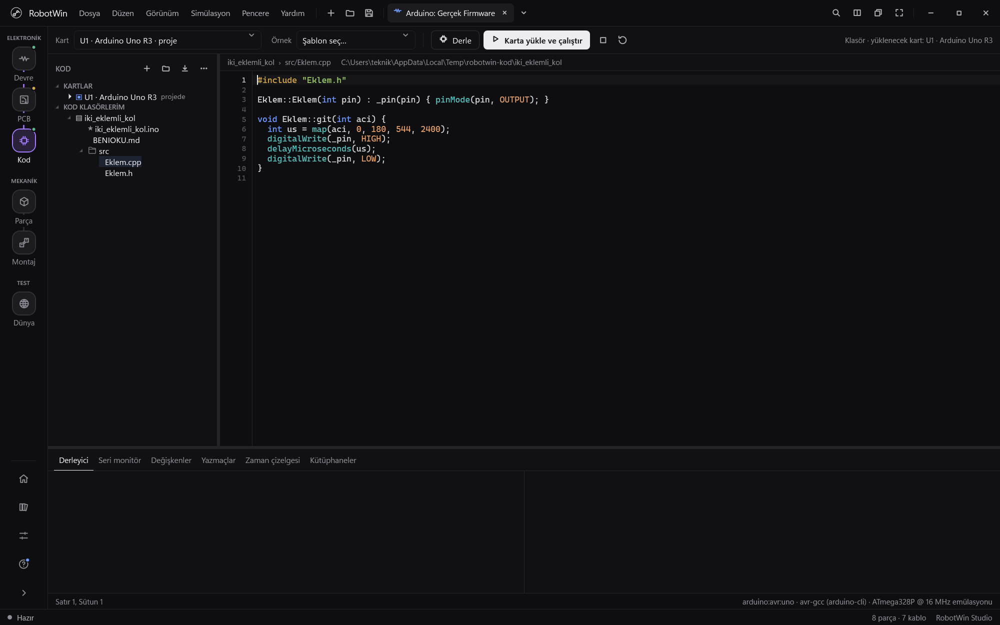
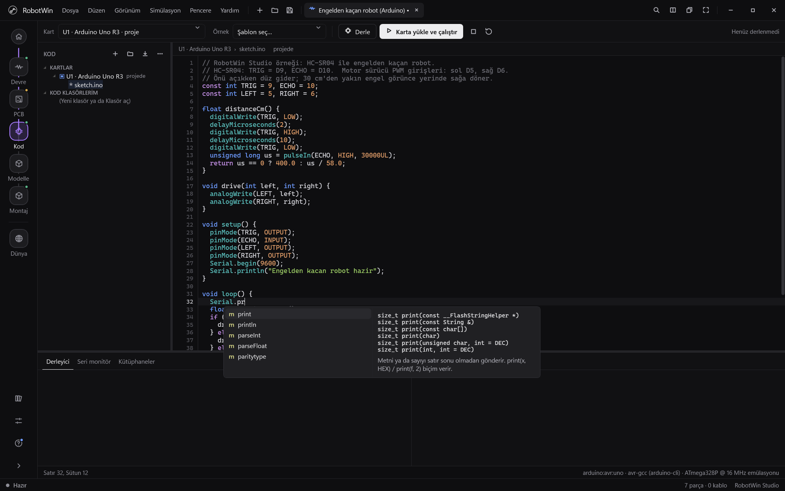

# 4. Kod

**Kod** sayfası (Ctrl+3), kartların yazılımını yazdığınız yerdir. Sayfa bir kod editörü gibi çalışır:

- solda klasörler ve dosyalar;
- ortada tamamlama ve imza yardımı olan editör;
- altta derleyici, seri monitör ve Arduino kütüphaneleri.

Yazdığınız kodu projedeki ya da açık dünyadaki **herhangi bir karta** (Arduino Uno, Arduino Nano, ESP32) yükleyip çalıştırabilirsiniz.



## Başlamadan önce

- Arduino kodu derlemek için `arduino-cli` kurulu olmalıdır:

  ```text
  winget install ArduinoSA.CLI
  arduino-cli core install arduino:avr
  ```

- ESP32 kodu derlemek için Visual Studio C++ araçları (MSVC) kurulu olmalıdır.

Ayrıntılar: [1. Başlarken](01-baslarken.md#kendi-kodunuzu-derlemek-için-isteğe-bağlı).

## Gezgin: kartlar ve kod klasörleri

Sol taraftaki gezginde iki bölüm vardır:

- **KARTLAR:** projedeki ve açık dünyadaki her programlanabilir kart. Her kartın kodu kendi klasöründe, projenin (ya da dünyanın) içinde saklanır.
- **KOD KLASÖRLERİM:** diskteki klasörler. Yeni klasörler `Belgeler\RobotWin\Kod` içinde açılır. Diskten açtığınız her klasör de burada listelenir (ör. Arduino IDE'nin bir çizim klasörü).

Gezginin üstündeki düğmeler:

| Düğme | Ne yapar |
| --- | --- |
| Yeni dosya | Seçili klasöre `.ino`, `.h`, `.cpp` … ekler |
| Yeni kod klasörü | Diskte yeni bir çizim klasörü açar |
| Klasör aç | Diskteki herhangi bir kod klasörünü listeye ekler |
| ⋯ | İçe aktar, diske kaydet, zip, yeniden adlandır, sil |

Bir klasöre ya da dosyaya sağ tıklayınca şunlar gelir:

- **Yeni dosya…**, **Yeni klasör…**: dosya ya da alt klasör ekler, ör. `src/`.
- **Dosya içe aktar…**, **Klasör içe aktar…**: başka yerden dosya ya da klasör kopyalar. Dosyaları Explorer'dan gezgine sürükleyip bırakmak da olur.
- **Karta yükle:** klasörü seçtiğiniz karta yükler.
- **Diske kaydet (Arduino çizim klasörü olarak)…**: istediğiniz yere kaydeder.
- **Zip olarak dışa aktar…**
- **Klasörü Explorer'da göster**, **Yeniden adlandır**, **Sil**.
- **Listeden kaldır (diskte kalır):** klasörü yalnızca listeden çıkarır.

Diskteki dosyalarda **Ctrl+S** kaydeder.

### Çok dosyalı çizimler

Bir çizim birden çok dosyadan oluşabilir: ana `.ino`, yanında `.h` / `.cpp` dosyaları ve `src/` altındaki alt klasörler. Arduino IDE'deki gibi hepsi birlikte derlenir. Bu hem Uno / Nano'da hem ESP32'de geçerlidir. Bir kartın klasörüne eklediğiniz dosyalar proje dosyasında saklanır.

## Adım adım: ilk kodunuz

1. Gezginde bir kart ya da kod klasörü seçin.
2. Klasör boşsa **Örnek** listesinden bir şablon seçin, örneğin **Blink (D13 LED)**.
3. **Kart** listesinden kodun yükleneceği kartı seçin. Listede projedeki ve açık dünyadaki her Uno, Nano ve ESP32 vardır.
4. **Derle** düğmesine veya **F7**'ye basın. Alttaki **Derleyici** sekmesinde çıktı görünür. Hatalar Türkçe açıklanır; hatanın olduğu dosya açılır ve satır işaretlenir.
5. **Karta yükle ve çalıştır** düğmesine veya **F5**'e basın. Klasördeki kod karta kopyalanır, derlenir ve simülasyon başlar. Kart dünyadaysa dünya çalışmaya başlar.
6. **Seri monitör** sekmesinde `Serial.print` çıktısını görün. Alttaki kutuya yazıp **Gönder** ile karta veri yollayın.

Araç çubuğundaki diğer düğmeler simülasyonu durdurur ve kartı resetler.

## Kod tamamlama ve imza yardımı

Editör, kartın gerçek başlık dosyalarını okur:

- Uno / Nano için Arduino AVR çekirdeğini, kurulu kütüphaneleri ve çizim klasörünü;
- ESP32 için simülasyon katmanını.



Tamamlama listesi şu durumlarda açılır:

- `.`, `->` ve `::` yazınca (ör. `Serial.` → `print`, `println`, `begin` …);
- `#include <` yazınca (kullanılabilir başlıklar);
- **Ctrl+Space** ile her yerde.

Liste sizin fonksiyonlarınızı, değişkenlerinizi ve `#define`'larınızı da bilir. Bir değişkenin türünü bildiği için `kol.` yazınca `Servo` sınıfının üyelerini gösterir.

Kullanım:

- **↑ ↓** ile seçin; **Enter** ya da **Tab** ile ekleyin; **Esc** kapatır.
- Sağdaki panel seçilen öğenin imzasını ve kısa açıklamasını gösterir.
- Parantez açınca fonksiyonun parametreleri satırın üstünde görünür ve yazdığınız parametre kalın olur. Kaybolursa **Ctrl+Shift+Space** geri getirir.

## Arduino kütüphaneleri

Alttaki **Kütüphaneler** sekmesi Arduino kütüphane listesinde arama yapar. Liste yaklaşık 10 000 kütüphane içerir ve bilgisayardaki `arduino-cli` listesinden okunur.

- Arama kutusuna ad ya da başlık yazın, ör. `servo`, `lcd i2c`, `dht`, `Servo.h`.
- **Kur ve ekle** düğmesi kütüphaneyi `arduino-cli lib install` ile indirir, kurar ve koda `#include` satırını ekler.
- Kurulu bir kütüphanenin başlık düğmeleri (ör. `Servo.h`) `#include` satırını ekler; **Kütüphaneyi kaldır** kütüphaneyi siler.
- Liste hiç indirilmemişse **Kütüphane listesini indir** düğmesi `arduino-cli lib update-index` çalıştırır.
- Kodda kurulu olmayan bir başlık varsa (ör. `#include <Servo.h>`) uyarı çıkar. Sekme o başlığı sağlayan kütüphaneyi gösterir.

ESP32 kartlarında da kurulu Arduino kütüphaneleri kullanılır:
- Çizim bir kütüphanenin başlığını içerince (`#include <AccelStepper.h>`) o kütüphane bulunur ve çizimle birlikte simülasyon katmanına derlenir. Kütüphanenin kendi bağımlılıkları da bulunur.
- Simülasyon katmanının kendi başlıkları (`Wire.h`, `Servo.h`, `WiFi.h` …) önceliklidir.
- Kütüphane değişince ya da güncellenince çizim yeniden derlenir.
- ESP32'nin yazmaçlarına doğrudan erişen kütüphaneler (ör. RMT ile LED şeridi süren) simülasyon katmanında bulunmayabilir. O zaman hata hangi kütüphanenin derlenemediğini söyler.


## Arduino şablonları

| Şablon | Ne yapar |
| --- | --- |
| Blink (D13 LED) | D13'teki LED'i saniyede bir yakıp söndürür |
| PWM ile parlaklık (D9) | D9'daki LED veya motorun gücünü yavaşça artırıp azaltır |
| Buton ile LED | D2'deki buton basılıyken D13'teki LED yanar |
| Analog okuma + seri | A0'daki gerilimi okuyup seri monitöre yazar |
| HC-SR04 mesafe | Ultrasonik sensörle mesafeyi cm olarak yazar |
| Engelden kaçan robot | HC-SR04 ve iki motorla engelden kaçar |
| Çizgi izleyen (2 sensör) | İki TCRT5000 ile çizgi izler |
| I²C tarayıcı | I²C veri yolundaki cihazların adreslerini bulur |
| MPU-6050 ivme | İvme ve jiroskop değerlerini okur |

ESP32 kartları için yeni kod, GPIO2'deki LED'i yakıp söndüren bir ESP32 Blink ile başlar.

## Arduino nasıl çalışır?

Kodunuz gerçek `avr-gcc` ile (`arduino-cli` üzerinden) derlenir. Ortaya çıkan HEX dosyası, çevrim doğruluğunda çalışan bir **ATmega328P emülatöründe** devreyle birlikte adım adım çalışır. Desteklenenler:

- Tüm komut seti ve kesmeler
- Dijital pinler, harici kesmeler ve pin değişim kesmeleri
- Timer0/1/2 ve PWM (`analogWrite`)
- Seri port (USART), ADC (`analogRead` devredeki gerçek gerilimi okur), EEPROM, watchdog
- I²C (TWI); SSD1306 OLED, PCF8574 + HD44780 LCD ve MPU-6050 modülleri gerçekten cevap verir

> İpucu: Arduino IDE'de derlediğiniz bir `.hex` dosyanız varsa, **Devre** sayfasındaki **Kart pinleri** sekmesinde **HEX yükle…** ile doğrudan yükleyebilirsiniz.

Program ile devre tek bir saatle ilerler. Uno, her zaman diliminin sonuna ait çevrime kadar çalışır; bir önceki dilimden taşan komut bir sonrakinden düşülür. Bu yüzden `millis()` ile devrenin zamanı arasında kayma birikmez: bir saniyenin sonunda program tam 16 000 000 çevrimdedir.

## Hata ayıklama: kesme noktası, adım, değişkenler

Arduino Uno ve Nano kodunu satır satır izleyebilirsiniz. Kart bir kesme noktasına geldiğinde çalıştığı yer de aynı anda durur: **Devre** sayfasındaki simülasyon ya da **Dünya**. Böylece kodu, devredeki gerilimleri ve akımları, kabloları ve dünyadaki parçaları aynı anda, aynı simüle edilmiş zamanda görürsünüz.

1. Kartın kodunu açın ve durmak istediğiniz satırın numarasına tıklayın. Satırda kırmızı bir nokta belirir. Kodu olmayan bir satıra (yorum, boş satır, değişken bildirimi) konan nokta, kodu olan bir sonraki satırda durur. Hiç durulamayacak bir satırdaki nokta içi boş bir halka olarak görünür.
2. **Karta yükle ve çalıştır** (F5) ile kodu derleyip yükleyin. Satır bilgisi derlemeyle birlikte gelir: kesme noktaları yalnız burada derlenmiş yazılımda çalışır.
3. Kart o satıra gelince durur:
   - satırda sarı bir ok ve bant belirir;
   - üstteki çubukta yer, fonksiyon ve simüle edilmiş zaman yazar;
   - **Değişkenler** sekmesi kodunuzdaki global ve `static` değişkenleri o anki değerleriyle gösterir.
4. Buradan devam edin:

| Düğme | Kısayol | Ne yapar |
| --- | --- | --- |
| **Devam** | F5 | Programı, devreyi ve dünyayı bir sonraki kesme noktasına kadar sürdürür |
| **Adım** | F10 | Bir sonraki satıra geçer; çağrılan fonksiyonlar (örneğin `delay`) durmadan çalışır |
| **İçine** | F11 | Çağrılan fonksiyonun içine, kodunuzdaki ilk satırına girer |
| **Dışına** | Shift+F11 | İçinde bulunulan fonksiyon dönene kadar çalışır |
| **Satırda dur** | — | Çalışan programı kodunuzun bir sonraki satırında durdurur |

Değerler kart çalışırken de yenilenir. Son bakıştan beri değişen değer turuncu görünür. Duran bir dünyayı **Dünya** sayfasındaki **Devam** düğmesiyle de sürdürebilirsiniz.


> `-Os` ile derlenen kodda derleyici bazı satırları birleştirir ya da başka satırların içine gömer. Bu yüzden adımlar bazen beklediğinizden farklı bir sırayla ilerler. Arduino IDE'nin hata ayıklayıcısında da durum aynıdır.

ESP32 çizimleri bilgisayarın işlemcisinde yerel olarak çalıştığı için kesme noktaları şimdilik yalnız Arduino Uno / Nano (ATmega328P) içindir.

## ESP32 nasıl çalışır?

ESP32 kodu (çizim) bilgisayarınızda MSVC ile yerel olarak derlenir ve devreyle eş zamanlı çalışır. İlk derleme biraz uzun sürer, çünkü ESP32 donanım katmanı da kurulur; sonraki derlemeler önbellekten hızlı gelir.

Desteklenenler:

- `pinMode`, `digitalRead/Write`, `attachInterrupt`
- `analogRead` (zayıflatma ve çözünürlük ayarlarıyla), `analogWrite`, `ledc*` PWM, `dacWrite`, `touchRead`, `tone`, `pulseIn`
- Donanım zamanlayıcıları, `millis`, `micros`, gecikmeler
- FreeRTOS görevleri, kuyruklar, semaforlar
- `Serial`, `Wire` (I²C), `EEPROM`, `Servo` / `ESP32Servo`
- `WiFi` (dünya içinde sanal ağ; İnternet yok), BLE (temel özellikler), **Bluepad32** (PS5, PS4, Xbox kumandaları)

- `SPI`: SPI cihazları (MCP3008 ADC, SPI'lı BMP280 …) devredeki SPI veri yoluna bağlanır.

## Gerçek ESP32 kartı: iki çalışma modu

ESP32 kartının denetçisinde **Çalışma modu** iki seçeneklidir:

- **hızlı simülasyon** (varsayılan): yukarıda anlatılan yol. Çok sayıda ESP32'li sahneler ve hızlı deneme için.
- **donanım uyumlu**: çizim, Espressif'in gerçek ESP32 araç zinciriyle (Arduino-ESP32 3.3.13, `xtensa-esp32-elf-gcc`) derlenir; çıktı gerçek karta yüklenebilir. Devre simülasyonunda bu yazılım, yongaya gidecek hâliyle, RobotWin'in kendi Xtensa emülatöründe çalışır: iki çekirdek, FreeRTOS, ROM ve yazmaç düzeyinde GPIO, LEDC (PWM), ADC, DAC, zamanlayıcılar, bekçiler, Serial, Serial1 ve Serial2 (iki yönde), I2C (Wire) ve SPI, karta bağlı modüllerle; böylece `analogRead` gerçek yonganın verdiği kodları verir (0 V yakınındaki ölü bölgesi, 3,1 V yakınındaki bükülmesiyle) ve seri monitör gerçek UART'ın tuttuğu hızı gösterir (115200 için 115942). Değişiklikten sonraki ilk çalıştırma çizimi arka planda gerçek yonga için derler ve bu arada hızlı modda çalışır; sonraki çalıştırma emülatördedir. Olay günlüğü hangi motorun çalıştığını yazar. Dünya simülasyonunda da aynısı geçerli. Henüz modellenmeyenler: Wi-Fi/BLE ve kamera; bunları kullanan bir çizim (WiFi.h, esp_now.h, BLEDevice.h, esp_camera.h …) hızlı modda çalışır ve olay günlüğü nedenini yazar.

Hangi modda olursanız olun, Kod sayfasında ESP32 seçiliyken **Gerçek kart** menüsü şunları yapar:

1. **ESP32 araç zincirini kur**: yalnız ilk seferde. Yaklaşık 1,3 GB indirilir, kurulu hali 4 GB'dir. RobotWin'in kendi klasörüne kurulur, Arduino IDE'nize dokunmaz.
2. **Gerçek kart için derle**: hatalar çizimin satırlarında gösterilir; durum satırı flaş ve RAM kullanımını yazar.
3. **Gerçek karta yükle → COMx**: USB kablosuyla bağlı kart listelenir; seçince çizim derlenip `esptool` ile yazılır. Kart yükleme kipine kendiliğinden geçer; geçmezse yükleme sırasında kartın BOOT düğmesine basılı tutun.
4. **Birleşik imajı (.bin) dışa aktar**: önyükleyici, bölüm tablosu ve uygulama tek dosyada; web tabanlı yükleyiciler ya da `esptool` ile 0x0 adresine yazılır.

İki modun ayrıntılı planı ve emülatörün aşamaları: [ESP32'nin iki çalışma modu](../gelistirici/ESP32_MODLARI.md).

## Dünyadaki kartların kodu

Açık dünyadaki her kart gezginin **KARTLAR** bölümünde kendi klasörüyle durur. Kodunu orada yazıp **Karta yükle ve çalıştır** ile yükleyebilirsiniz. Dünyada kartı seçip denetçideki **Kartın kodunu yaz** düğmesine basmak da aynı klasörü açar. Bir kod klasörünü dünyadaki bir karta yüklemek için klasöre sağ tıklayıp **Karta yükle** altından kartı seçin. Ayrıntılar: [7. Dünya](07-dunya.md).

---

[← Önceki: 3. PCB](03-pcb.md) · [İçindekiler](README.md) · [Sonraki: 5. Parça →](05-modelle.md)
