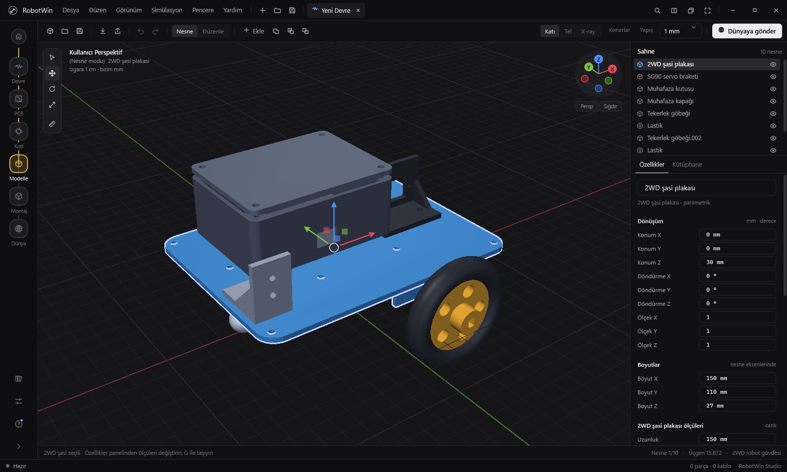
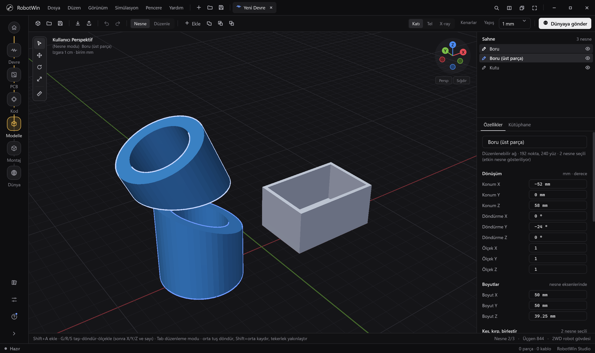
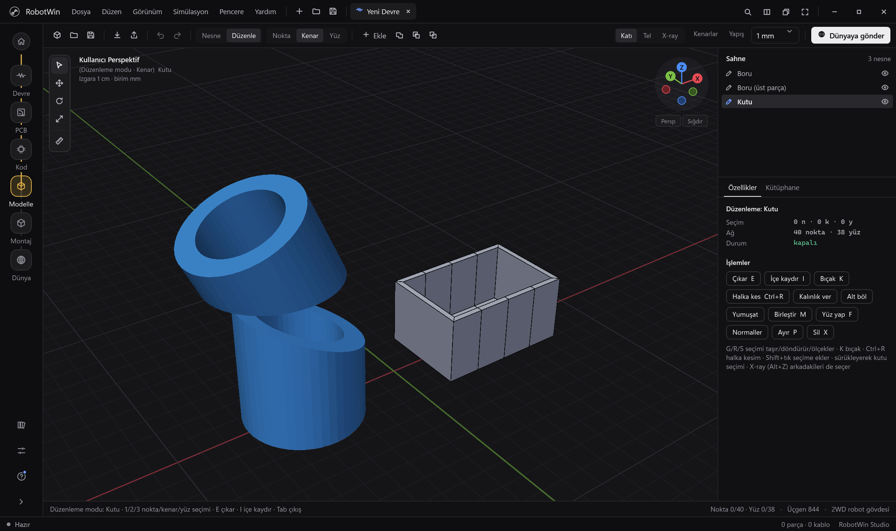
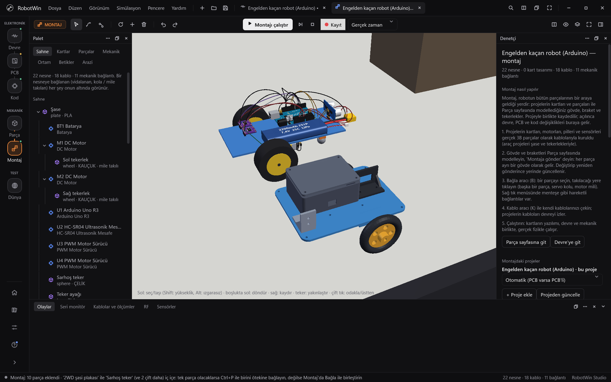

# 5. Parça

**Parça** sayfası (Ctrl+4) robotunuzun mekanik parçalarını (şase, braket, kutu, tekerlek göbeği…) 3 boyutlu modellediğiniz yerdir. Çalışma şekli Blender'a benzer: nesne modu, düzenleme modu ve klavyeyle hızlı dönüşümler.

Bir dosyada istediğiniz kadar parça olur:
- Sağdaki **Parçalar** listesinde en üstteki her nesne ayrı bir parçadır.
- Bir nesneyi ötekine bağlarsanız (**Ctrl+P**) ikisi tek parça olur; örneğin bir göbeğe takılı lastik.
- Biten parçaları **Montaja gönder** ile robotun [Montaj](06-montaj.md)'ına koyarsınız; her biri ayrı bir gövde olur.

## Gezinme

| Fare / tuş | İşlev |
| --- | --- |
| Orta tuşla sürükle | Görünümü döndür |
| Shift + orta tuşla sürükle | Kaydır |
| Tekerlek | Yakınlaştır / uzaklaştır |
| Numpad 1 / 3 / 7 | Önden / sağdan / üstten görünüm |
| Numpad 5 | Perspektif / ortografik |
| Home | Her şeyi sığdır |
| Numpad . | Seçime odaklan |

## Nesne ekleme

**Ekle** düğmesi veya **Shift+A** ile:

- **Temel şekiller:** Kutu, Silindir, Koni, Küre, Simit, Boru, Kama, Delikli plaka.
- **Profil:** dikdörtgen, daire, çokgen, kanal veya serbest bir çizimi kalınlık vererek uzatın (ekstrüzyon).
- **Döndürme:** bir profili eksen etrafında döndürerek gövde oluşturun.
- **Robot parçaları:** 2WD şasi plakası, SG90 servo braketi, L braket, Tekerlek göbeği, Muhafaza kutusu + kapak. Bunların ölçüleri sonradan değiştirilebilir.

## Taşıma, döndürme, ölçekleme

1. Nesneyi tıklayarak seçin (**A** hepsini seçer, **Alt+A** seçimi kaldırır).
2. **G** taşı, **R** döndür, **S** ölçekle.
3. İsterseniz **X**, **Y** veya **Z** ile bir eksene kilitleyin ve bir sayı yazın (örneğin `G` `X` `20` → X yönünde 20 mm).
4. **Enter** onaylar, **Esc** iptal eder.

Ekrandaki taşıma / döndürme / ölçekleme tutamaçlarını da sürükleyebilirsiniz. **Yapış** açıkken ızgaraya yapışır; **Ctrl** basılıyken yapışma geçici olarak kapanır.

## Boolean (CSG) işlemleri

Delik açmak, cep oymak veya parçaları birleştirmek için:

1. Önce "araç" nesneleri, en son asıl nesneyi seçin (en son seçilen etkin nesnedir; Shift+tık seçime ekler).
2. Özellikler panelindeki **Kes, kırp, birleştir** bölümünden (ya da araç çubuğundan, sağ tık menüsünden) seçin:
   - **Fark (kırp):** iç içe geçen araçların hacmini etkin nesneden oyar (delik, cep, kırpma).
   - **Birleşim:** araçları etkin nesneyle tek kapalı gövdede birleştirir.
   - **Kesişim:** yalnızca ortak hacmi bırakır.

Araç nesneleri işlemden sonra kaldırılır; sonuç yine kapalı (su geçirmez) bir gövdedir.

## Dilimleme

Bir nesneyi iki parçaya ayırmak için nesneyi seçin ve **K**'ye (ya da **Dilimle**) basın. Ekranda kesme çizgisinin başına ve sonuna tıklayın: nesne o çizgi boyunca, bakış yönünde kesilir. İki parça da kesit yüzüyle kapatılır, yani ikisi de kapalı gövdedir. Kesitteki delikler açık kalır (boru kesilince halka kesit çıkar). Sonra parçalardan birini seçip **G** ile taşıyabilir, **R** ile döndürebilirsiniz.

Diğer nesne işlemleri: **Ctrl+J** birleştir, ayna kopya (X / Y / Z), doğrusal ve dairesel dizi, **Ctrl+P** ebeveyn yap, **Alt+P** ebeveyni kaldır, **Shift+D** çoğalt, **H** gizle, **Alt+H** hepsini göster.

## Düzenleme modu

**Tab** ile düzenleme moduna geçin. **1**, **2**, **3** tuşları nokta, kenar ve yüz seçimidir. Seçili noktaları, kenarları ya da yüzleri **G** / **R** / **S** ile taşıyın, döndürün, ölçekleyin (nesne modundaki gibi eksen kilidi ve sayı girişiyle).

Seçim: **Alt+tık** (sürüklemeden) tıklanan kenarın halkasını seçer, yüz modunda yüz halkasını; **Shift+Alt+tık** ekler. **L** seçimle bağlantılı bütün parçayı seçer. **Ctrl+Numpad +/−** seçimi bir halka büyütür ya da küçültür.

| Tuş | İşlev |
| --- | --- |
| E | Ekstrüzyon: yüzleri normal yönünde çıkarır; nokta/kenar modunda seçili kenarlardan yeni yüz çekip taşır |
| I | İçe öteleme (inset) |
| K | Bıçak: ekrana çizilen çizgi boyunca keser (seçim varsa yalnız seçili yüzleri). **C** kipi değiştirir: kes / sağ tarafı sil / sol tarafı sil; silinen tarafın açıklığı kapatılır |
| Ctrl+R | Halka kesim: fareyle bir kenarın üzerine gelin, dörtgen halkası boyunca yeni kenar halkaları eklenir; tekerlek veya +/− kesim sayısını değiştirir |
| Ctrl+B | Pah kır (bevel): seçili kenarların yerine düz pah yüzü; fareyle genişlik ya da mm yazın. Üç pahın buluştuğu köşeye köşe yüzü eklenir |
| F | Yüz doldur |
| M | Birleştir |
| P | Seçimi ayrı nesne yap |
| X veya Del | Sil |
| Shift+N | Normalleri yeniden hesapla |

**Kalınlık ver** yüzeye içe doğru et kalınlığı verir: açık bir yüzey kalın bir duvar olur, kapalı bir gövde içi boş kabuğa döner (örneğin üst yüzü silinmiş kutu → tepsi). Köşelerde kalınlık eşit kalır.

**Alt böl**, **Yumuşat** (Catmull–Clark), mesafeye göre birleştirme, üçgenleme ve normalleri ters çevirme gibi işlemler panelde ve sağ tık menüsündedir.

## Malzeme ve kütle

Her nesneye bir malzeme (PLA, PETG, ABS, Naylon, Akrilik, Kontrplak, MDF, FR4, Alüminyum, Çelik, Karbon, Kauçuk) ve doluluk oranı (3D baskı için) verin. Kütle hacimden otomatik hesaplanır; dünyaya gönderdiğinizde bu kütle kullanılır.

## Görünüm modları

- **Katı** (Z), **Tel** kafes (Shift+Z), **X-ray** (Alt+Z), **Kenarlar**.
- **Ölç** aracı: iki noktaya tıklayın, mesafeyi gösterir (köşelere yapışır).

## Kaydetme ve dışa aktarma

- Model `.rwmodel` dosyası olarak kaydedilir (Ctrl+S).
- **İçe aktar:** STL, OBJ, PLY.
- **Dışa aktar:** STL (mm), OBJ, PLY. Açık (kapalı olmayan) ağlar için uyarı verir. 3D yazıcıya göndermek için STL kullanın.

## Montaja gönder

**Montaja gönder** düğmesi seçili parçaları (seçim yoksa hepsini) projenin [Montaj](06-montaj.md)'ına gönderir:

- Her parça hesaplanan kütlesiyle ayrı bir gövde olur.
- Parçalar modellendikleri düzenle gelir ve montajda var olanların yanına, yere kurulur.
- Projenin montajı henüz yoksa önce kurulur. Parça sayfasından ayrılmazsınız.
- Bir parçayı değiştirip yeniden gönderince yerinde güncellenir. Kendi orijini ve bağlantıları yerinde kalır.
- İç içe duran iki ayrı parça için uyarı çıkar. Silinen parçalar montajdan kaldırılsın mı diye sorulur.

Bir parçayı test dünyasına engel ya da rampa gibi **tek bir gövde** olarak koymak için sağ tık menüsünden **Test dünyasına tek gövde olarak koy** deyin. Bu seçenek montajı değil, açık bir test dünyasını hedefler.

---

[← Önceki: 4. Kod](04-kod.md) · [İçindekiler](README.md) · [Sonraki: 6. Montaj →](06-montaj.md)
