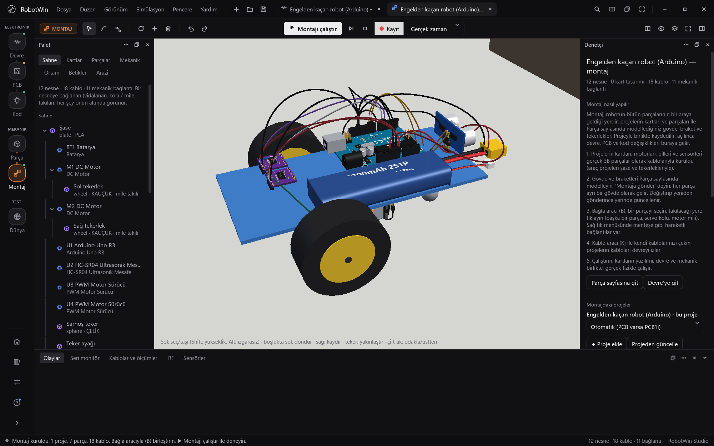
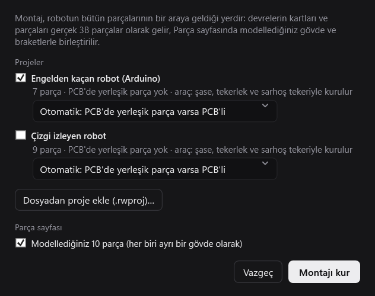
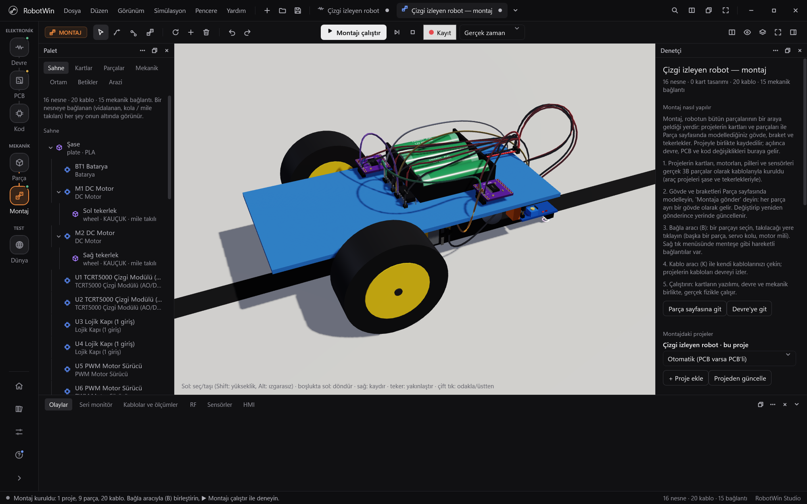

# 6. Montaj

**Montaj** (Ctrl+5) robotun bütün parçalarının bir araya geldiği yerdir:
- projelerinizin kartları ve parçaları gerçek 3B parçalar olarak gelir,
- [Parça](05-modelle.md) sayfasında modellediğiniz gövde, braket ve tekerleklerle birleşir.

Montaj projenin bir parçasıdır:
- proje dosyasının içinde saklanır,
- **Ctrl+S** projeyle birlikte kaydeder,
- her açılışta projedeki devre, PCB ve kod değişikliklerini alır.

Her şey [Dünya](07-dunya.md) sayfasıyla aynı gerçek fizikle çalışır. Montaj açıkken sayfanın solunda turuncu **MONTAJ** rozeti görünür. Çalıştır düğmesi de **Montajı çalıştır** der.

## Montajı kurmak

Bir projede **Montaj**'a ilk kez geçince ne geleceği sorulur. Hiçbir şey sessizce tahmin edilmez.

- **Projeler:** bu proje ve açık diğer projeler listelenir. Her proje için bir biçim seçersiniz:
  - **PCB'li:** PCB sayfasında karta yerleştirilmiş parçalar tek bir kart olarak gelir, lehimli halleriyle. Motor, pil, servo gibi kartın dışındaki parçalar ayrı gelir ve kablolarla karta bağlanır.
  - **PCB'siz:** her parça ayrı gelir ve pin pin kablolanır; atlama kablolu bir prototip gibi.
  - **Otomatik:** PCB'de yerleşik parça varsa PCB'li, yoksa PCB'siz.
- **Dosyadan proje ekle:** başka bir `.rwproj` dosyası da aynı montaja gelir ve var olanların yanına kurulur. Birden çok projenin devresi böyle tek montajda birleşir.
- **Parça sayfası:** modellediğiniz parçalar da gelsin mi? Her biri ayrı bir gövde olur.

Robot örneklerinde (**Robot: Engelden Kaçan**, **Robot: Çizgi İzleyen**) pencere sorulmaz: örnek robotun kendisidir.

## Neyi nereye koyar?

| Projede | Montajda |
| --- | --- |
| PCB'ye yerleştirilmiş parçalar (PCB'li biçimde) | Kartın üstünde; kart tek bir nesnedir, devresi ve kodu içindedir |
| Diğer parçalar (motor, servo, pil, sensör, Arduino/ESP32 modülü…) | Her biri kendi gerçek 3B parçası |
| Hatlar (net) | Kablolar; atlama kabloları 5 cm adımlarla gerçek uzunlukta. Kartın pinleri `RefDes.Pin` biçiminde görünür (ör. `J2.1`) |
| Aracın mekaniği (iki motorlu gezgin) | Şase plakası, motor millerine takılı tekerlekler, sarhoş teker. Kart, pil ve modüller şasenin üstüne birbirine değmeden yerleşir; sensörler mekaniğin söylediği yerde durur; robot arenasının başlangıç noktasındadır |

Bir araçta sağ motor gerçek kitlerdeki gibi aynalı takılır ve kabloları ters bağlanır. Böylece koddaki "ileri" gerçekten ileri gider.

Yeni gelen her proje var olanların yanına, yere kurulur. Hiçbir şey başka bir şeyin içinde başlamaz; iç içe başlayan gövdeleri fizik birbirinden fırlatırdı.

## Montaj projeyi izler

Montajı her açtığınızda, ya da sağdaki **Projeden güncelle** ile, projedeki değişiklikler gelir:

- Devreye eklenen parça montaja eklenir ve kablolanır. Silinen parça kaldırılır.
- Değişen parça (tür, değer) ve kod yerinde güncellenir. Kart, PCB'nin ve kodun son halini alır.
- Kablolar hatları izler.

Sizin yaptıklarınız korunur:
- parçaları koyduğunuz yerler,
- kurduğunuz bağlantılar,
- kendi çektiğiniz kablolar.

Montaj parçaları adlarıyla değil kimlikleriyle izler: devrede bir parçanın adını değiştirmek (R1 → R7) onu montajda yerinde bırakır, yalnız adı değişir.

Durum çubuğu neyin değiştiğini yazar.

Montajdaki kartın kodu projenin kodudur. **Kod** sayfası bu kartları ayrı kart diye göstermez; kodu projede yazarsınız. Montajda bir kartı seçip **Kartı düzenle** deyince kopyası değil, projenin kendisi açılır.

## Montajdaki projeler

Denetçide, hiçbir şey seçili değilken, **Montajdaki projeler** bölümü bulunur:

- Her projenin biçimi değiştirilebilir (PCB'li / PCB'siz / Otomatik). Montaj hemen yeni biçime geçer.
- **+ Proje ekle:** başka bir projeyi ekler.
- **Montajdan çıkar:** projenin kartı, parçaları ve kabloları kalkar.

## Parça sayfasından gelen parçalar

Parça sayfasında **Montaja gönder** her parçayı ayrı bir gövde olarak gönderir:

- Parçalar modellendikleri düzenle gelir; örneğin şase ve tekerlekleri yerli yerinde. Montajda var olanların yanına, yere kurulurlar.
- Bir parçayı değiştirip yeniden gönderince şekli, kütlesi ve malzemesi yerinde güncellenir. Parça bir tarafa doğru büyüse de kendi orijini (dolayısıyla vida delikleri ve bağlantıları) yerinde kalır.
- Parça sayfasında sildiğiniz bir parça montajda duruyorsa, kaldırılsın mı diye sorulur.
- İç içe duran iki ayrı parça (ör. lastik ve göbeği) için uyarı çıkar. Tek parça olacaklarsa Parça sayfasında **Ctrl+P** ile birini ötekine bağlayın; ayrı kalacaklarsa montajda **Bağla** ile birleştirin.

## Bağlamak ve denemek

1. **Bağla** (B): bir parçayı seçin, takılacağı yere tıklayın. Bu başka bir parça, servo kolu ya da motor mili olabilir. Sağ tık menüsünde menteşe gibi hareketli bağlantılar vardır.
2. **Kablo** (K) ile kendi kablolarınızı çekin.
3. **Montajı çalıştır** (F5): kartların yazılımı, devre ve mekanik birlikte çalışır. Motorlar devrenin hesapladığı hızla döner, sensörler dünyayı ölçer, yük ve çarpmalar devreye geri yansır.
4. **Denemek için ortam:** sağdaki listeden atölye, boş zemin, oval ya da sekiz çizgi pisti, engelli ya da rampalı alan seçin. Robot montajıyla birlikte ortamın başlangıç noktasına taşınır.

Birden çok robotu ya da özel bir test alanını [Dünya](07-dunya.md) sayfasındaki ayrı dünyalarda kurarsınız.

## Çakışma algılama

Araç çubuğunda **Hizala**'nın yanındaki **Çakışma algılama** düğmesi (komut paletinde "çakışma algıla"), SolidWorks'teki gibi aynı yeri kaplayan parça çiftlerini ortak hacimleriyle (mm³) listeler. Parçalar kendi 3B modellerinin dış şekilleriyle, bulundukları yerde karşılaştırılır. Seçenekler:

- **Değen yüzeyleri de çakışma say:** yalnızca değen parçalar da listelenir.
- **Eklemle bağlı parçaları da denetle:** servo koluyla servo, tekerle motor gibi bilerek iç içe olanlar da sayılır (öntanımlı olarak atlanır).
- **Yalnız seçili parça:** seçili parçanın başkalarıyla çakışmaları.

Bir satır seçilince ilk parça seçilir, durum çubuğu çakışmanın hacmini ve ortasını söyler. Pencere açıkken sahnede çalışılabilir; **Hesapla** yeniden denetler.

## Boşluk doğrulama

**Boşluk doğrulama** düğmesi (komut paletinde "boşluk doğrula"), SolidWorks'teki gibi birbirine **En az boşluk**'tan (mm) yakın duran parça çiftlerini en kısa mesafeleriyle listeler: kablonun bükülme payı, fanın nefes alanı, tolerans. Mesafe parçaların dış şekilleri arasında kesin olarak ölçülür (GJK). Bir satır seçilince sahnede iki uç arasına boşluğu gösteren bir çizgi çizilir. Çakışan çiftler "çakışıyor" diye listelenir (kapatılabilir); eklemle bağlı parçalar ve yalnız seçili parça seçenekleri çakışma algılamadaki gibidir.

## Patlatılmış görünüm

**Patlatılmış görünüm** düğmesi parçaları adım adım ayırır (montaj sırası, bakım, belgeler); yalnız görüntüdür, parçaların yeri değişmez.

- **Yeni adım:** sahnede bir parça seçin, yön (±X, ±Y, ±Z ya da ortadan dışa doğru) ve uzaklık verip **Adım ekle**. Parçaya bağlı olanlar onunla birlikte gider; kendi adımları üstüne eklenir.
- **Otomatik patlat:** en büyük serbest parça yerinde kalır. Bir parçaya bağlı her parça ondan bir **Aralık** uzaklaşır, böylece zincir (servo, kol, ikinci servo…) kat kat açılır; serbest parçalar eksen boyunca sırayla ya da ortadan dışa doğru ayrılır. En derindeki parça önce çıkar.
- **Adımlar** listesinde sıra **Yukarı**/**Aşağı** ile değişir, adım silinir. Adımlar dünyayla birlikte kaydedilir ve geri alınabilir.
- **Görünüm** kaydırıcısı toplu hâlden patlatılmışa adım adım ilerler; **Oynat** ve **Topla** bunu canlandırır. Kablolar ayrılan uçlar arasında gevşek çizilir. Pencere kapanınca montaj toplu hâline döner.

## Kayıt ve arıza deneyleri

Montaj bir dünya olduğu için dünyanın bütün araçları burada da çalışır:
- **Kayıt** ile simülasyonu kaydedip render penceresinde yeniden oynatabilirsiniz.
- Pil kısa devresi ya da motor sıkışması gibi arızaları deneyebilirsiniz.
- **Görünüm → Isı kamerası** ve **Görünüm → Çarpışma şekilleri** ile içeri bakabilirsiniz.

---

[← Önceki: 5. Parça](05-modelle.md) · [İçindekiler](README.md) · [Sonraki: 7. Dünya →](07-dunya.md)
