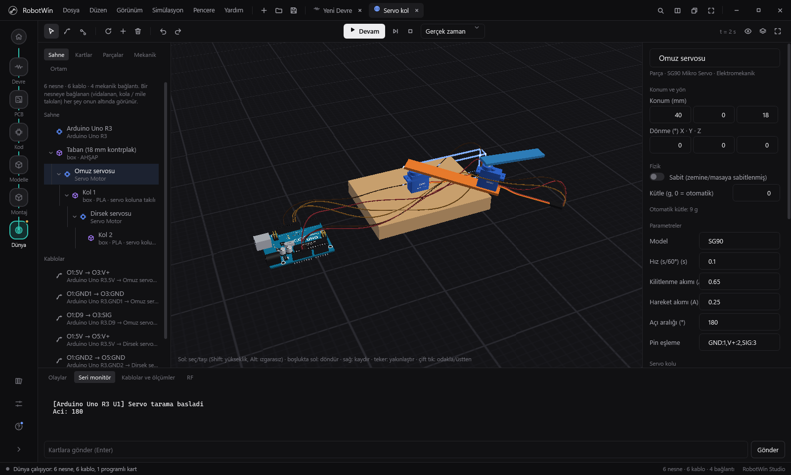
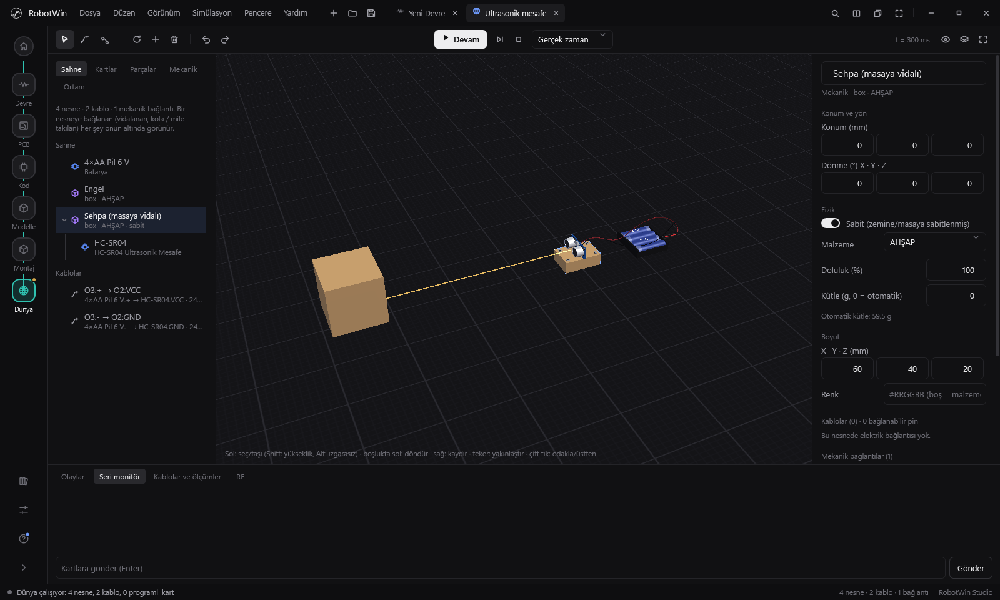
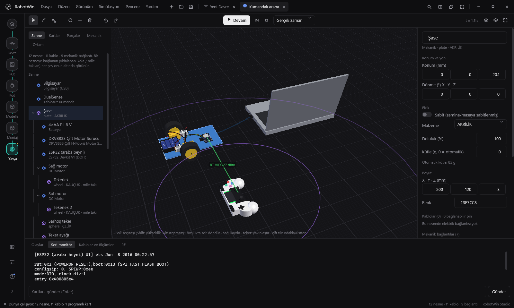

# 7. Dünya

**Dünya** sayfası (Ctrl+6) her şeyin bir araya geldiği yerdir. Tasarladığınız kartları, katalogdaki parçaları, mekanik gövdeleri ve 3D modelleri gerçek fizikli bir ortama koyar, kablolarla bağlar, vidalar veya menteşelerle birleştirir ve hepsini birlikte çalıştırırsınız. Devre, kartların yazılımı, radyo ve fizik aynı anda, adım adım hesaplanır.

## Bir dünya açmak

- **Yeni dünya** (Ctrl+Shift+N): 4 × 3 m'lik boş bir atölye.
- **Bu devreyi yeni bir dünyaya koy:** açık devrenizi bir kart olarak yeni dünyaya koyar.
- **Aç…:** kayıtlı bir `.rwworld` dosyası.
- **Dünya şablonları** (Başlangıç sayfası veya **Dosya → Dünya şablonundan**):

| Şablon | İçerik |
| --- | --- |
| Boş atölye | 4 × 3 m zemin, 25 °C |
| Kabloyla bağlı iki kart | 9 V güç kartı ve LED kartı ayrı PCB'lerde; iki kablo bağlanınca LED'ler yanar |
| Arduino ile iki eksenli servo kol | Uno iki SG90 servoyu sürer; ikinci servo birincinin koluna vidalı |
| Arduino, LCD ve OLED (I²C kablolu) | Uno, 16×2 LCD, 128×64 OLED ve potansiyometre I²C kablolarıyla bağlı |
| İki tekerlekli araba (gerçek fizik) | PLA şase, iki TT motor ve tekerlek, bilyeli sarhoş teker, 4×AA pil |
| Ultrasonik mesafe sensörü ve engeller | HC-SR04 önündeki engele gerçekten ölçüm yapar |
| Pil, motor ve tekerlek | 4×AA pil TT motoru sürer, tekerlek motor milinde |
| Kumandalı araba (ESP32 + PS5 kumanda) | ESP32 + Bluepad32, DRV8833, iki TT motor, USB'li bilgisayar ve eşleşmiş DualSense |

## Ekranın bölümleri

- **Üst araç çubuğu:** Seç ve taşı, **Kablo çek** (K), **Bağla** (B), döndür, çoğalt, sil, geri al / yinele; **Dünyayı çalıştır**, **10 ms ilerlet**, **Durdur ve başa dön**, hız seçimi; kamera takibi, üstten görünüm, hepsini sığdır.
- **Sol panel sekmeleri:** **Sahne**, **Kartlar**, **Parçalar**, **Mekanik**, **Ortam**.
- **Ortada** 3D görünüm.
- **Sağda** denetçi: seçili nesnenin adı, konumu, fiziği, kabloları ve bağlantıları.
- **Alt sekmeler:** **Olaylar**, **Seri monitör**, **Kablolar ve ölçümler**, **RF**.

## Adım adım: ilk dünyanız

Bu örnekte bir pil bir motoru, motor da bir tekerleği döndürecek.

1. **Yeni dünya** (Ctrl+Shift+N) açın.
2. **Parçalar** sekmesinde aramaya `pil` yazın ve **4×AA Pil 6 V**'u ekleyin. Sonra `motor` yazıp **TT Redüktörlü Motor 1:48**'i ekleyin.
3. Motoru seçin. Sağdaki **Fizik** bölümünde **Sabit (zemine/masaya sabitlenmiş)** anahtarını açın. Böylece motor dönerken yerinden kaçmaz.
4. **Mekanik** sekmesinden bir **Tekerlek** ekleyin.
5. Tekerlek seçiliyken **Bağla** aracını (B) seçin ve motora tıklayın. Açılan menüden **"Motor miline sabitle (birlikte döner)"** seçeneğini seçin.
6. **Kablo çek** aracını (K) seçin. Pilin `+` pinine, sonra motorun bir pinine tıklayın. Aynısını pilin `−` pini ve motorun diğer pini için yapın. Fare bir pinin üstündeyken pinin adı, canlı gerilimi ve kaç kablo bağlı olduğu görünür.
7. **Dünyayı çalıştır** (F5). Motor döner, tekerlek döner, motor sesi duyulur.
8. Alttaki **Kablolar ve ölçümler** sekmesinde her kablonun akımını, gücünü ve yük yüzdesini görün.
9. **Durdur ve başa dön** (Shift+F5) ile her şeyi başlangıç durumuna getirin.

## Nesne türleri

### Kartlar

Kendi tasarladığınız devre + PCB + kod üçlüsü. **Kartlar** sekmesinde:

- **Açık sekmeden:** açık bir devreyi karta dönüştürüp ekler.
- **Proje dosyasından kart ekle (.rwproj)…**
- **Yeni boş kart tasarla**
- **Hazır modül kartları:** Arduino Uno, Arduino Nano, ESP32 DevKit V1, ESP32 DevKitC, fırçalı uçuş kontrolcüsü.

Aynı tasarımı birden çok kez koyabilirsiniz; kopyalar aynı devreyi paylaşır. Kart seçiliyken denetçide:

- **Kartı düzenle (devre · PCB · kod):** kart kendi sekmesinde açılır.
- **Kartın kodunu yaz:** kartın kodunu Kod sayfasında açar ([4. Kod](04-kod.md)).
- **Ayrı proje dosyası olarak dışa aktar…**

### Parçalar

Katalogdaki tek bir parça: servo, motor, pil, sensör, ekran, Arduino… **Parçalar** sekmesinde arama kutusu ve kategoriler vardır: Geliştirme, Elektromekanik, Güç, Sensör, Ekran, Anahtarlama, **Kablosuz ve USB**. Parametreleri denetçideki **Parametreler** bölümünden değiştirin.

Tek başına konmuş bir Arduino veya ESP32'yi **Kart tasarımına dönüştür ve kodunu aç** ile programlanabilir bir karta dönüştürebilirsiniz.

### Mekanik gövdeler

**Mekanik** sekmesindeki **Temel şekiller:** Kutu, Plaka / şase, Kol / çubuk, Silindir, Tekerlek (kauçuk lastikli), Küre / bilye, Masa / sabit zemin. Boyut ve renk denetçiden ayarlanır.

### 3D modeller

**Dışarıdan model → 3D model içe aktar (STL, OBJ, PLY)…** ile kendi modelinizi ekleyin. Kütle, ağırlık merkezi ve eylemsizlik malzemeden hesaplanır. Modelle sayfasında yaptığınız parçaları **Dünyaya gönder** ile doğrudan buraya getirebilirsiniz ([5. Modelle](05-modelle.md)).

## Kablolar

- Her kablonun bir kesiti (AWG), uzunluğu ve rengi vardır. Varsayılan 24 AWG'dir; DC motor veya pil bağlarken 22 AWG.
- Kablonun direnci gerçek bakır direncidir. Akım sınırı aşılırsa kablo ısınır ve yanar; **Kablolar ve ölçümler** sekmesinde **YANDI** yazar.
- Kartlar, bir kablo bağlanana kadar elektriksel olarak birbirinden ayrıdır. İki kart arasında sinyal taşıyorsanız GND'yi de bağlayın.
- Kabloyu kaldırmak için denetçide **Kabloyu sök**'e basın.

## Mekanik bağlantılar

Bir nesne seçiliyken **Bağla** (B) aracıyla başka bir nesneye tıklayın:

| Seçenek | Ne olur |
| --- | --- |
| **Servo kolu / Motor miline sabitle (birlikte döner)** | Nesne servo koluna veya motor miline takılır ve onunla döner. Yalnızca hedefin kolu veya mili varsa çıkar. |
| **… gövdesine sabitle (vida / yapıştırıcı)** | İki nesne tek parça gibi hareket eder |
| **Menteşe ile bağla (serbest döner)** | Bir eksen etrafında serbest döner |
| **Kızakla bağla (doğrusal kayar)** | Bir doğru boyunca kayar |

Birbirine bağlı parçalar birbiriyle çarpışmaz. Bir nesneyi sürüklediğinizde ona takılı her şey de gelir. Bağlantıyı kaldırmak için denetçide **Bağlantıyı çöz**.

## Fizik ve ortam

Her nesnenin denetçisinde **Fizik** bölümü:

- **Sabit:** nesne zemine veya masaya sabitlenmiştir, hareket etmez.
- **Malzeme:** PLA, PETG, ABS, Akrilik, Alüminyum, Çelik, Karbon, Ahşap, MDF, Kauçuk, FR4. Sürtünme ve sekme malzemeye göre değişir.
- **Doluluk (%)** ve **Kütle (g, 0 = otomatik)**.

**Ortam** sekmesi:

- **Yerçekimi:** Dünya 9.81, Ay 1.62, Mars 3.71, Jüpiter 24.8, Sıfır yerçekimi.
- **Ortam sıcaklığı**, **zemin genişliği / derinliği**, **zemin sürtünmesi (μ)**, **çevre duvarları**.
- **Engel ekle** / **Engelleri temizle**.

Servolar devreden gelen darbe komutunu okur; kolun açısı ve çektiği akım devreye geri döner. DC motorlar devrenin hesapladığı hızla döner; mile binen yük motora geri yansır. Sert çarpmalar ve kopan bağlantılar **Olaylar** sekmesine yazılır.

## Sensörler ve ekranlar

- **HC-SR04 ultrasonik sensör** dünyadaki nesnelere ışın göndererek gerçekten ölçer. Işın ve çarptığı nokta mesafeye göre renklenerek çizilir.

  

- **I²C ekranlar** (SSD1306 OLED, 16×2 LCD) kartın yazdıklarını 3D modelin üzerinde canlı gösterir.
- LED'ler ve lambalar yanar; aşırı ısınan parçalar kızarır, bozulan parçalardan kıvılcım çıkar.

## Kumandalar, radyo ve USB

**Parçalar → Kablosuz ve USB** kategorisinde: DualSense (PS5), DualShock 4 ve Xbox kumandaları, **Bilgisayar + USB kablosu**, **Wi-Fi Modem (2.4 GHz)**, **BLE Beacon Etiketi**, **IR Kumanda (NEC, 21 tuş)**, **TSOP38238 IR Alıcı**.

### Kumanda

1. Kumandayı seçin. Denetçide **Eşleştirme modu (PS + Create basılı)** ile ESP32'yle eşleştirin.
2. **Sanal kumandayı aç (fare / klavye)** ile ekrandaki kumandayı kullanın, ya da gerçek bir kumandayı USB veya Bluetooth ile bilgisayara bağlayın. Görünmezse **Kumandaları yeniden tara**.
3. **ESP32'ye uzaklık** kaydırıcısı (simülasyon çalışırken) sinyalin uzaklıkla nasıl zayıfladığını gösterir.
4. **Kumandayı aç/kapat** ve **Eşleşmeyi unut** düğmeleri de buradadır.

ESP32 seçiliyken **Örnek kodu yükle: kumandalı araba (Bluepad32)** hazır bir araba kodu yükler.

### USB

**Bilgisayar** nesnesini bir karta yöneltip **USB'yi tak** deyin. Kablo takılıyken kart 5 V ile beslenir ve kartın seri portu **Seri monitör** sekmesine bağlanır. **USB'yi çıkar** ile ayırın.

### Radyo ortamı

Wi-Fi, BLE ve Bluetooth sinyalleri uzaklıkla, engellerle ve gövdelerle zayıflar. Alttaki **RF** sekmesinde cihazlar, sinyal gücü (RSSI), kanal ve saniyedeki paket sayısı görünür. **Sönümleme**, **Dalgalar** ve **Bağlantı çizgileri** seçenekleri radyo görselleştirmesini açar / kapatır. IR kumanda yalnızca görüş hattında çalışır; tuşları denetçideki **IR kumanda tuşları (NEC)** bölümündedir.

## Sahne ağacı

**Sahne** sekmesi dünyadaki her şeyi neyin neye takılı olduğuna göre ağaç olarak gösterir (örneğin "servo koluna takılı", "mile takılı", "sabit"). Çalışırken 60 °C üstündeki sıcaklıkları ve **ARIZALI** nesneleri gösterir. Altında **Kablolar** listesi vardır. Sağ tık: **Odakla**, **Alt nesneleri gizle/göster**; çift tık nesneye odaklanır.

## Çalıştırma

| Düğme / tuş | İşlev |
| --- | --- |
| **Dünyayı çalıştır** / **Duraklat** / **Devam** (F5) | Başlat, duraklat, sürdür |
| **10 ms ilerlet** | Tek adım |
| **Durdur ve başa dön** (Shift+F5) | Durdurur, her şeyi başlangıç konumuna getirir |
| Hız | 0.01×, 0.1×, 0.5×, Gerçek zaman, 5× |

Kartta yazılım yoksa **Olaylar** sekmesine "Yüklü yazılım yok (kart boşta)" yazılır.

## Analiz modu

Gerçek zamanlı çalıştırma ekrana yetişmek zorundadır; **analiz modu** ise dünyayı ekrandan bağımsız olarak, sizin seçtiğiniz süre ve doğrulukta baştan sona hesaplar. **Simülasyon › Analiz modu** menüsünden ya da Dünya sayfasında **Ctrl+F5** ile açılır. Analiz dünyanın bir kopyası üzerinde çalışır; bu sırada dünyayı düzenlemeye devam edebilirsiniz.

**Ayarlar**

- **Hazır ayar:** Gerilme, Isı, Akış, Tam analiz ya da Özel.
- **Doğruluk:** Hızlı (1 ms fizik), Standart (0,5 ms), Hassas (0,1 ms, 24 çözücü geçişi, uyumaya izin yok) ve Referans (0,05 ms). Devre çözücüsünün adımı ve toleransı da buna göre küçülür.
- **Süre** ve **kayıt hızı:** örneğin 3 s boyunca saniyede 1000 örnek.
- **Gerilme (FEM):** işaretlediğiniz parçalar kayıt boyunca aldıkları temas ve eklem yükleriyle çözülür. Ağ ikinci derece dörtyüzlülerden oluşur; ince uzun parçalarda kiriş elemanları kullanılır. Serbest parçalar atalet dengesiyle (inertia relief) çözülür. Sonuç von Mises gerilmesi, yer değiştirme ve malzemenin akma sınırına göre emniyet katsayısıdır.
- **Akış (CFD):** seçilen parçanın akış yönündeki düşey kesiti etrafında lattice-Boltzmann akışı hesaplanır. Sonuç sürükleme (Cd) ve kaldırma (Cl) katsayıları, girdap kopma frekansı (Strouhal), tahmini sürükleme kuvveti ve girdaplılık haritasıdır. Yüksek Reynolds sayılarında Smagorinsky türbülans modeli kullanılır.
- **Isı:** kartlardaki her bileşenin kayıtlı gücü, PCB'deki gerçek yerinden ısı kaynağı olur; iletim, taşınım (h) ve ışınım çözülür. **Sonra ısıtmaya devam** süresiyle, örneğin bir regülatörün kararlı sıcaklığına ulaşması izlenebilir.

**Sonuçlar**

- **Grafikler:** kaydedilen bütün kanallar (gövde konumu, hızı, ivmesi; eklem açısı, torku, gücü; her parçanın akım, gerilim ve güç sinyalleri; devre düğümleri). Arama kutusuyla süzün, aynı anda altı kanala kadar seçin.
- **Gerilme:** deforme edilmiş parça üzerinde renkli gerilme haritası (fareyle sürükleyerek döndürülür) ve en kritik anın değerleri. Emniyet katsayısı 1'in altındaysa parça akar ya da kırılır.
- **Akış** ve **Isı:** alan haritaları ve zamana bağlı grafikler.
- **Günlük:** ayarlar, ağ bilgileri, olaylar ve seri port çıktısı.

Sonuçlar **Kaydet** ile `.rwanalysis` dosyasına yazılır ya da **CSV olarak dışa aktar** ile her kanal bir sütun olarak MATLAB, Python veya Excel'e taşınır.

## Fare ve klavye

| Fare | İşlev |
| --- | --- |
| Nesneyi sol tuşla sürükle | Taşı (takılı her şeyle birlikte) |
| Shift + sürükle | Yüksekliği değiştir |
| Alt + sürükle | 5 mm ızgarayı yok say |
| Boşlukta sol tuşla sürükle | Görünümü döndür |
| Sağ tuşla sürükle | Kaydır |
| Tekerlek | Yakınlaştır |
| Nesneye çift tık / boşluğa çift tık | Odaklan / üstten görünüm |

| Tuş | İşlev |
| --- | --- |
| K | Kablo çek |
| B | Bağla |
| R / Shift+R | 15° döndür / ters yönde döndür |
| Ctrl+D | Çoğalt |
| Del | Sil |
| Ctrl+Z / Ctrl+Y | Geri al / yinele |
| T | Kamera seçili nesneyi takip etsin |
| F | Seçime / her şeye sığdır |
| Esc | İptal, seçme aracına dön |

Nesneler yalnızca simülasyon dururken taşınabilir. Konumu ve açıyı denetçideki **Konum ve yön** alanlarına sayı yazarak da girebilirsiniz.

## Kaydetme

**Kaydet** (Ctrl+S) dünyayı `.rwworld` dosyası olarak saklar. İçindeki kartlar tam projeleriyle (devre, PCB, kod) birlikte kaydedilir; dosyayı başka bir bilgisayarda açtığınızda her şey hazırdır.

---

[← Önceki: 6. Montaj](06-montaj.md) · [İçindekiler](README.md) · [Sonraki: 8. Ölçü aletleri →](08-olcu-aletleri.md)
