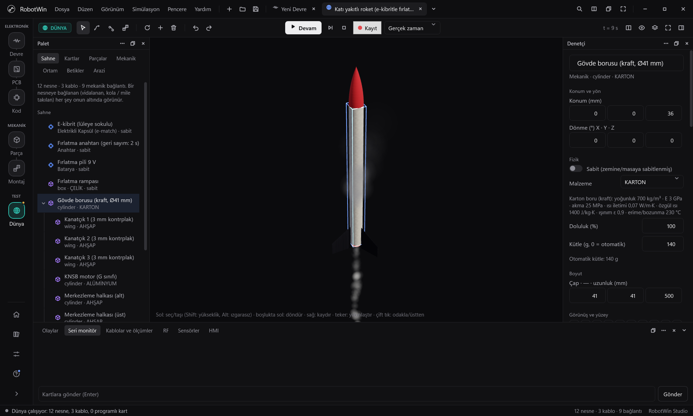
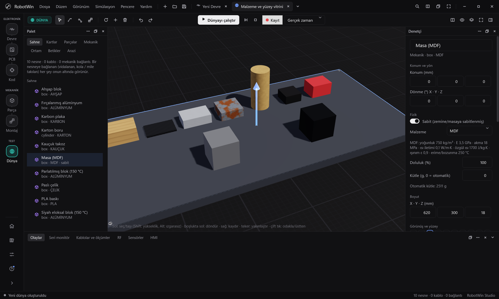

# 7. Dünya

**Dünya** sayfası (Ctrl+6) her şeyin bir araya geldiği yerdir. Tasarladığınız kartları, katalogdaki parçaları, mekanik gövdeleri ve 3D modelleri gerçek fizikli bir ortama koyar, kablolarla bağlar, vidalar veya menteşelerle birleştirir ve hepsini birlikte çalıştırırsınız. Devre, kartların yazılımı, radyo ve fizik aynı anda, adım adım hesaplanır.


## Denetçi: nesnenin özellikleri

Sağdaki **Denetçi** seçili nesnenin yalnızca gerçekten kullandığı bölümleri gösterir: önce ad, konum ve yön, fizik (sabitlik, malzeme, kütle), boyut ve görünüş; sonra nesnenin türüne özgü bölümler (kart, bileşen, kanat bağlantısı, kabuk, anahtar, kumanda). Bir gövdeye eklenebilen ek fizikler (**Kabuk**, **Basınçlı kap**, **Kurtarma paraşütü**, **Hava (özel ayar)**, **Davranış**) yalnızca açıksa görünür ve başlıklarında **Kaldır** vardır; diğerleri **Özellikler → Özellik ekle ▾** menüsündedir.

## Bir dünya açmak

- **Yeni dünya** (Ctrl+Shift+N): 4 × 3 m'lik boş bir atölye.
- **Bu devreyi yeni bir dünyaya koy:** açık devrenizi bir kart olarak yeni dünyaya koyar.
- **Aç…:** kayıtlı bir `.rwworld` dosyası.
- **Dünya şablonları** (Başlangıç sayfası veya **Dosya → Dünya şablonundan**):

| Şablon | İçerik |
| --- | --- |
| Boş atölye | 4 × 3 m zemin, 25 °C |
| Kabloyla bağlı iki kart | 9 V güç kartı ve LED kartı ayrı PCB'lerde; iki kablo bağlanınca LED'ler yanar |
| Arduino ile iki eksenli servo kol | Uno iki SG90 servoyu sürer; ikinci servo birincinin koluna vidalı |
| Arduino, LCD ve OLED (I²C kablolu) | Uno, 16×2 LCD, 128×64 OLED ve potansiyometre I²C kablolarıyla bağlı |
| İki tekerlekli araba (gerçek fizik) | PLA şase, iki TT motor ve tekerlek tek aks üzerinde, bilyeli sarhoş teker, 4×AA pil |
| Ultrasonik mesafe sensörü ve engeller | HC-SR04 önündeki engele gerçekten ölçüm yapar |
| Pil, motor ve tekerlek | 4×AA pil TT motoru sürer, tekerlek motor milinde |
| Fabrika hücresi (robot kol + konveyör) | 6 eksenli kol, konveyör bandı, ışık perdesi |
| SCARA al-bırak (paralel tutucu) | SCARA kol parçaları paralel tutucuyla taşır |
| Pervane itki standı | 8520 motorlar ve pervaneler: devir, itki, tork, akım canlı |
| Mini drone kalkışı | Dört 8520 motorlu 40 g X gövde itkiyle havalanır |
| ESP32 dörtlü | Fırçasız motorlar, ESC'ler, MPU-6050; ESP32'deki uçuş yazılımı gövdeyi dengede tutar |
| Elektronik kutusu | Kapaklı içi boş gövde, içinde Uno ve 9 V pil; sığma denetimi, röntgen ve patlatılmış görünüm |
| Motorlu planör (İHA) | 1 m planör, 2212 fırçasız motor, ESP32 uçuş kartı; denge yalnız pilin konumuyla |
| Planör | Balsa gövde, karbon kuyruk borusu, Nano + iki servo, itme çubukları; elden atılır |
| Mekanum tekerlekli araba | Dört TT motor ve mekanum tekerleklerle yana kayar |
| Işıklar: LED'ler ve lambalar | Karanlık odada LED'ler, RGB LED, güç LED'i, ampul ve LED şerit |
| Kumandalı araba (ESP32 + PS5 kumanda) | Kendi PCB'li ESP32 + DRV8833 kartı, USB-C şarjlı 2S pil, eşleşmiş DualSense |
| PS5 kumandalı uçak: pistten kalkış, ESP32 uçuş kartı | 1 m eğitim uçağı, kanatçıklar, üç tekerlekli iniş takımı, Bluepad32 uçuş kartı, model uçak sahası ([ayrıntı](#ps5-kumandalı-uçak)) |
| Su roketi | 2 L PET şişe, 0,6 L su, 4 bar; su jeti, hava itkisi, kanatçıklar |
| Katı yakıtlı motor test standı (KNSB) | İki BATES şeker yakıt tanesi; basınç ve itki yanma hızından çıkar |
| Katı yakıtlı roket: e-kibritle fırlatma ve paraşüt | G sınıfı KNSB motorlu 41 mm roket; 2 s geri sayımla kapanan anahtar e-kibriti ateşler, roket ~1 km'ye çıkar, tepe noktasında paraşüt açılır |
| Kap ve bilyeler: içi boş parçalar | Modelleyicide yapılmış tepsi ve boru; bilyeler ve küpler tepsinin içine, bir bilye borunun deliğinden yere düşer |
| Su bardağı: servo suyu döker | ESP32, yan yatırılmış bir SG90'ın kolundaki cam bardağı 90° devirir; 193 ml su kâseye dökülür ([sıvılar](#sıvılar)) |
| Çizgi izleyen robot | Mat, solmuş ve parlak bant üstünde 5 kanallı TCRT5000 |
| Sensör gezgini | Kamera, LiDAR, GPS, IMU, pusula ve enkoderler canlı |
| ESP32 + OV2640 kamera ile bant bulma | Kamera pisti yukarıdan görür, ESP32 bandı bulur |
| Rüzgâr, fan, konveyör ve ifadeler | Türbülanslı rüzgâr, fan, konveyör ve ifadeyle yazılan kuvvetler |
| Arazi parkuru, Kapalı atölye | Şekillendirilmiş arazi, boyalı zemin katmanları |

## Ekranın bölümleri

- **Üst araç çubuğu:** Seç ve taşı, **Kablo çek** (K), **Bağla** (B), döndür, çoğalt, sil, geri al / yinele; **Dünyayı çalıştır**, **10 ms ilerlet**, **Durdur ve başa dön**, hız seçimi; kamera takibi, üstten görünüm, hepsini sığdır.
- **Sol panel sekmeleri:** **Sahne**, **Kartlar**, **Parçalar**, **Mekanik**, **Ortam**.
- **Ortada** 3D görünüm.
- **Sağda** denetçi: seçili nesnenin adı, konumu, fiziği, kabloları ve bağlantıları.
- **Alt sekmeler:** **Olaylar**, **Seri monitör**, **Kablolar ve ölçümler**, **RF**, **Sensörler**.

### Panelleri yerleştirme

Palet, denetçi ve alt sekmelerin her biri (Olaylar, Seri monitör, Kablolar ve ölçümler, RF, Sensörler) taşınabilir bir paneldir:

- **Ayrı pencereye almak:** Panelin başlığını ya da alttaki sekmesini tutup sürükleyin. Panel kendi penceresine kopar ve fareyle birlikte gelir; başlıktaki pencere düğmesi de aynı işi yapar. Pencereyi ikinci ekrana taşıyabilirsiniz. Ayrı penceredeki panel de simülasyon sırasında canlı güncellenir.
- **Kenara yerleştirmek:** Ayrı pencereyi başlığından sürükleyip ana pencerenin üzerine getirince **Sol**, **Sağ** ve **Alt** kılavuzları çıkar. Fare bir kenara yaklaşınca panelin oturacağı alan vurgulanır, bırakınca panel oraya yerleşir. Ortada bırakılan pencere ayrı kalır. Pencerenin üstündeki **Sola / Sağa / Alta** düğmeleri sürüklemeden yerleştirir. Pencereyi kapatmak paneli son durduğu yere geri koyar.
- **Aynı kenarda birden çok panel:** Aynı kenara konan paneller üst üste dizilir. Aralarındaki çizgiyi sürükleyerek yüksekliklerini, kenar çizgisini sürükleyerek sütun genişliğini ayarlayın. Örneğin Seri monitörü denetçinin altına, Olaylar'ı paletin altına alıp alt bölmeyi kapatarak sahneyi büyütebilirsiniz.
- **Panel menüsü:** Başlıktaki **⋯** düğmesi ya da başlığa veya sekmeye sağ tık: **Solda**, **Sağda**, **Alt bölmede (sekme)**, **Ayrı pencerede**, **Yukarı / Aşağı taşı**, **Gizli**. Palet ve denetçi alt bölmeye konamaz.
- **Panel düzeni** (araç çubuğunun sağ ucundaki düğme) ya da **Görünüm → Dünya panelleri:** her panelin nerede olduğunu gösterir ve değiştirir. Gizlenen paneller buradan geri açılır. Ayrıca **Alt bölmeyi göster**, **Sol ve sağ panelleri yer değiştir**, **Ayrı pencereleri geri yerleştir** ve **Düzeni sıfırla** buradadır.

Düzen, ayrı pencerelerin konumu ve boyutu dahil saklanır; programı kapatıp açtığınızda aynen gelir. Sahne + Oyun görünümünde (G) **Paneller** kapalıyken kenar sütunları ve alt bölme gizlenir, ayrı penceredeki paneller açık kalır.


## Adım adım: ilk dünyanız

Bu örnekte bir pil bir motoru, motor da bir tekerleği döndürecek.

1. **Yeni dünya** (Ctrl+Shift+N) açın.
2. **Parçalar** sekmesinde aramaya `pil` yazın ve **4×AA Pil 6 V**'u ekleyin. Sonra `motor` yazıp **TT Redüktörlü Motor 1:48**'i ekleyin.
3. Motoru seçin. Sağdaki **Fizik** bölümünde **Sabit (zemine/masaya sabitlenmiş)** anahtarını açın. Böylece motor dönerken yerinden kaçmaz.
4. **Mekanik** sekmesinden bir **Tekerlek** ekleyin.
5. Tekerlek seçiliyken **Bağla** aracını (B) seçin ve motora tıklayın. Açılan menüden **"Motor miline sabitle (birlikte döner)"** seçeneğini seçin.
6. **Kablo çek** aracını (K) seçin. Pilin `+` pinine, sonra motorun bir pinine tıklayın. Aynısını pilin `−` pini ve motorun diğer pini için yapın. Fare bir pinin üstündeyken pinin adı, canlı gerilimi ve kaç kablo bağlı olduğu görünür.
7. **Dünyayı çalıştır** (F5). Motor döner, tekerlek döner, motor sesi duyulur.
8. Alttaki **Kablolar ve ölçümler** sekmesinde her kablonun akımını, gücünü ve yük yüzdesini görün.
9. **Durdur ve başa dön** (Shift+F5) ile her şeyi başlangıç durumuna getirin.

## Nesne türleri

### Kartlar

Kendi tasarladığınız devre + PCB + kod üçlüsü. **Kartlar** sekmesinde:

- **Açık sekmeden:** açık bir devreyi karta dönüştürüp ekler.
- **Proje dosyasından kart ekle (.rwproj)…**
- **Yeni boş kart tasarla**
- **Hazır modül kartları:** Arduino Uno, Arduino Nano, ESP32 DevKit V1, ESP32 DevKitC, fırçalı uçuş kontrolcüsü.

Aynı tasarımı birden çok kez koyabilirsiniz; kopyalar aynı devreyi paylaşır. Kart seçiliyken denetçide:

- **Kartı düzenle (devre · PCB · kod):** kart kendi sekmesinde açılır.
- **Kartın kodunu yaz:** kartın kodunu Kod sayfasında açar ([4. Kod](04-kod.md)).
- **Ayrı proje dosyası olarak dışa aktar…**

### Parçalar

Katalogdaki tek bir parça: servo, motor, pil, sensör, ekran, Arduino… **Parçalar** sekmesinde arama kutusu ve kategoriler vardır: Geliştirme, Elektromekanik, Güç, Sensör, Ekran, Anahtarlama, **Kablosuz ve USB**. Parametreleri denetçideki **Parametreler** bölümünden değiştirin.

Tek başına konmuş bir Arduino veya ESP32'yi **Kart tasarımına dönüştür ve kodunu aç** ile programlanabilir bir karta dönüştürebilirsiniz.

### Mekanik gövdeler

**Mekanik** sekmesindeki **Temel şekiller:** Kutu, Plaka / şase, Kol / çubuk, Silindir, Tekerlek (kauçuk lastikli), Küre / bilye, Masa / sabit zemin. Boyut ve renk denetçiden ayarlanır. **Gövde kabukları** (kapaklı içi boş gövdeler) içinde kart ve pil taşır; **Uçuş yüzeyleri** (kanat, irtifa dümenli yatay kuyruk, yön dümenli dikey kuyruk) gerçek kaldırma, sürükleme ve moment üretir.

### Çarpışma şekilleri

Her parçanın katı gövdesi kendi 3D modelinden çıkarılır: yuvarlak bir motor gövdesi yuvarlanır, kanat sivrilen biçimiyle, kumanda kendi dış hattıyla çarpışır (sınır kutusu değil). Bacaklar, pinler ve kablo uçları gibi ince parçalar gövdeye katılmaz. **Görünüm → Çarpışma şekilleri (dünya)** fiziğin gerçekten çarpıştırdığı gövdeleri modellerin üzerinde yarı saydam çizer; simülasyon çalışırken gövdelerle birlikte hareket eder. İçi boş modeller (modelleyicide yapılmış ya da içe aktarılmış tepsi, kap, boru, U braket) dışbükey parçalara ayrılır; böylece içlerine bir şey konabilir, bir bilye borunun deliğinden geçer. Örnek: **Kap ve bilyeler** şablonu. Matematiği: [Katı cisim ve temas](../fizik/02-mekanik.md).


### Basınçlı kaplar ve roketler

**Mekanik → Basınçlı kaplar ve roketler** bölümünde PET şişe (su roketi), hava tankı, katı yakıtlı motor ve roket kanatçığı vardır. Silindir, kutu veya küre bir gövdeyi denetçide **Özellik ekle → Basınçlı kap (gaz fiziği)** ile basınçlı kap yapabilirsiniz:

- **Gaz, basınç, iç hacim, duvar, su:** kabın içindekiler. Gaz ideal gaz yasasıyla (p·V = m·R·T) hesaplanır.
- **Lüle:** boğaz ve çıkış çapı, jetin çıktığı yüz. Akış izentropiktir; basınç oranı yeterince yüksekse boğazda ses hızına ulaşır, genişleyen lüle gazı süpersonik hızlandırır. İtki ṁ·vₑ + (pₑ − pₐ)·Aₑ olarak gövdeye lülenin olduğu yerden uygulanır.
- **Vana açılır (s):** rampa lüleyi bu ana kadar kapalı tutar.
- **Su:** lüleyi kapattığı sürece önce su çıkar (Bernoulli; roketin ivmesi suyu lüleye bastırır), sonra hava.
- **Katı yakıt:** KNSB, KNDX veya APCP tanesi; yanma hızı basınca bağlıdır (r = a·pⁿ). Oda basıncı, yanma yüzeyinin ürettiği gaz ile lüleden çıkan gazın dengesinden kendiliğinden çıkar; itki eğrisi hazır okunmaz. Motora bağlı bir **e-match** devreden ateşlenince ya da **Ateşleme zamanı** gelince tutuşur.
- **Patlama:** basınç, duvarın çeper gerilmesini (σ = p·r/t) malzemenin dayanımına çıkarırsa kap patlar.

Kabın kütlesi gaz, su ve yakıt azaldıkça düşer; sıcak gaz duvarı ve lüle boğazını ısıtır (ısı kamerasında görünür). Çalışırken denetçide basınç, sıcaklık, itki, yakıt yüzeyinin sıcaklığı, yanan yüzey oranı ve durum canlı okunur. **Su roketi**, **Katı yakıtlı motor test standı** ve **Katı yakıtlı roket** şablonlarıyla başlayın. Matematiği: [Gaz ve roketler](../fizik/05-gaz-ve-roket.md).

### Ateşleme ve fırlatma

Katı yakıt, e-kibrit ateşlendiği an yanmaz. E-kibrit ve üzerindeki ateşleyici barutu yanar, sıcak gazı yakıt yüzeyini ısıtır; yüzeyi tutuşma sıcaklığına çıkan bölge yanar ve alev lüleye doğru yayılır. Denetçide **Ateşleyici barutu (g)** ve **Ateşleyici yanma süresi (ms)** ayarlanır. Barutu 0 yaparsanız yalnız e-kibrit başı kalır; şekerli yakıt çoğu zaman tutuşmaz ve olay günlüğü nedenini yazar ("yakıt yüzeyi en çok 122 °C oldu").

E-kibriti ateşlemenin iki yolu var:

- **Fırlatma kontrolcüsü:** pil → anahtar → e-kibrit → pil. Anahtarın denetçisinde **Kendiliğinden kapanır (s)** bir geri sayım verir. Simülasyon çalışırken **Kapat** düğmesi anahtarı elle kapatır.
- **Kartla:** bir MOSFET'i karttan sürüp e-kibriti ateşleyin (ör. altimetre ya da uzaktan kumanda ile).

E-kibrit, motorun **Ateşleme** ayarında seçilir ya da motora mekanik olarak bağlanır.

### Paraşüt

Herhangi bir gövdeye denetçide **Özellik ekle → Kurtarma paraşütü** ile paraşüt verin ve **Kanopi çapı (m)** girin. Paraşüt, altimetre tırmanmanın bittiğini görünce (ya da **Açılma zamanı**nda) atılır. Kanopi, ipler gerilince dolma süresiyle açılır; açılma şoku ve iniş hızı fizikten çıkar. Çalışırken kanopi sahnede çizilir.




### Sıvılar


**Mekanik → Sıvılar** bölümünden su dolu ya da boş bir cam bardak, veya bir su hacmi (kutu ya da silindir) eklenir. Sıvı nesnesinin kutusu ya da silindiri, dünya başlarken sıvının dolduracağı hacimdir; içinde duran katı parçaların yeri boş kalır. Denetçide sıvının türü seçilir: su, deniz suyu, etil alkol, süt, ayçiçek yağı, gliserin, bal. Her birinin gerçek yoğunluğu, viskozitesi ve yüzey gerilimi kullanılır.

- Sıvı parçacıklarla çözülür ve kabın duvarlarına gerçek basıncını uygular. Bir bardak suyun ağırlığını taşır, suya bırakılan bir parça kaldırma kuvveti görür, bal yavaş akar.
- Cam (malzeme **CAM**) ve akrilik saydam çizilir; su bardağın içinden görünür. Bir silindire **tube.wall** ile et kalınlığı, **tube.bottom** ile taban verilince bardak ya da kap olur.
- Canlı görüntüde sıvı başına yaklaşık 3000 parçacık kullanılır ve sıvı her 1 ms'de çözülür; durgun su "uyur".
- Render her şeyi tam hesaplar (doğruluk ayarına göre 6000–30 000 parçacık, her fizik adımında) ve sıvıyı daha ince bir yüzeyle yeniden oynatır.

Denklemler ve doğrulama: [Sıvılar](../fizik/07-sivilar.md).

### 3D modeller

**Dışarıdan model → 3D model içe aktar (STL, OBJ, PLY)…** ile kendi modelinizi ekleyin. Kütle, ağırlık merkezi ve eylemsizlik malzemeden hesaplanır. Parça sayfasında yaptığınız bir parçayı sağ tık menüsündeki **Test dünyasına tek gövde olarak koy** ile buraya getirebilirsiniz. Robotun parçaları ise **Montaja gönder** ile robotun montajına gider ([5. Parça](05-modelle.md), [6. Montaj](06-montaj.md)).

## Kablolar

- Her kablonun bir kesiti (AWG), uzunluğu ve rengi vardır. Varsayılan 24 AWG'dir; DC motor veya pil bağlarken 22 AWG.
- Kablonun direnci gerçek bakır direncidir. Akım sınırı aşılırsa kablo ısınır ve yanar; **Kablolar ve ölçümler** sekmesinde **YANDI** yazar.
- Kartlar, bir kablo bağlanana kadar elektriksel olarak birbirinden ayrıdır. İki kart arasında sinyal taşıyorsanız GND'yi de bağlayın.
- Kabloyu kaldırmak için denetçide **Kabloyu sök**'e basın.

## Mekanik bağlantılar

Bir nesne seçiliyken **Bağla** (B) aracıyla başka bir nesneye tıklayın:

| Seçenek | Ne olur |
| --- | --- |
| **Servo kolu / Motor miline sabitle (birlikte döner)** | Nesne servo koluna veya motor miline takılır ve onunla döner. Yalnızca hedefin kolu veya mili varsa çıkar. |
| **… gövdesine sabitle (vida / yapıştırıcı)** | İki nesne tek parça gibi hareket eder |
| **Menteşe ile bağla (serbest döner)** | Bir eksen etrafında serbest döner |
| **Kızakla bağla (doğrusal kayar)** | Bir doğru boyunca kayar |

En çok iki eklemle birbirine bağlı parçalar birbiriyle çarpışmaz. Bir nesneyi sürüklediğinizde ona takılı her şey de gelir. Bağlantıyı kaldırmak için denetçide **Bağlantıyı çöz**.

### Vidalama, yapıştırma, bant, kelepçe, lehim

Sabit bir bağlantının denetçide **bağlantı türü** seçilir. Seçim yalnız bir etiket değildir; bağlantının üç fiziğini belirler:

1. **Dayanım:** Vidada parça başına taşınan yük × vida sayısı, yapıştırıcıda kayma dayanımı × yapışan alan alınır. Yapışan alan, küçük parçanın en geniş yüzünün yarısı sayılır. Bağlantıdan geçen kuvvet bunu aşarsa bağlantı kopar ve olay günlüğüne yazılır.
2. **Isı geçişi:** Isı, bağlantı katmanından (iletkenlik ÷ kalınlık) ve gerçekten değen yüzey payından geçer. İnce yapıştırıcı katmanı ısıyı vida başlarından çok daha iyi geçirir: epoksiyle birleşen iki alüminyum blok bir dakikada aynı sıcaklığa gelir, kelepçeyle aralarında 55 K fark kalır.
3. **Sıcaklık:** Yapıştırıcılar ve plastik dişler ısınınca yumuşar. Dayanım, yumuşama sıcaklığından bırakma sıcaklığına kadar doğrusal düşer. Bağlantının sıcaklığı, iki parçanın ısı ağındaki ortalamasıdır. Sıcak tutkalla tavana yapıştırılmış 1 kg'lık blok 25 °C'de tutar, parçalar 95 °C'deyken düşer.

| Bağlantı türü | Dayanım | Isı geçişi (katman, temas payı) | Yumuşar → bırakır |
| --- | --- | --- | --- |
| Sabit (belirtilmemiş) | kırılmaz | 400 W/m²K, %15 | — |
| M3 vida + somun (2 adet) | 2 × 1000 N | 400 W/m²K, %15 | — |
| Plastiğe vida (M3, 2 adet) | 2 × 250 N | 400 W/m²K, %12 | 60 → 110 °C |
| Japon yapıştırıcısı (siyanoakrilat) | 6 MPa × alan | 4000 W/m²K, %50 | 80 → 120 °C |
| Epoksi | 15 MPa × alan | 2000 W/m²K, %70 | 60 → 110 °C |
| Sıcak tutkal | 1,5 MPa × alan | 400 W/m²K, %30 | 55 → 85 °C |
| Çift taraflı köpük bant | 0,5 MPa × alan | 100 W/m²K, %80 | 90 → 150 °C |
| Kelepçe (zip bağı) | 220 N | 400 W/m²K, %5 | 80 → 160 °C |
| Lehim (Sn63/Pb37) | 30 MPa × alan | 200 000 W/m²K, %30 | 150 → 183 °C |

Kapak (kutu kapağı) ayrıca **vidalı** işaretlenebilir; kenara oturduğunda vidalanır, oturmazsa "vidalanamıyor" uyarısı çıkar.

## Fizik ve ortam

Her nesnenin denetçisinde **Fizik** bölümü:

- **Sabit:** nesne zemine veya masaya sabitlenmiştir, hareket etmez.
- **Malzeme:** fiziğin bildiği her malzeme: PLA, PETG, ABS, PET, Akrilik, Alüminyum, Çelik, Bakır, Kurşun, Karbon, Ahşap, Kontrplak, Balsa, MDF, Karton, Kauçuk, FR4. Sürtünme ve sekme malzemeye göre değişir. Listenin altındaki kart malzemenin sayılarını gösterir: yoğunluk, elastisite modülü, akma dayanımı, ısı iletimi, özgül ısı, ışınım ve yumuşama/erime sıcaklığı.
- **Doluluk (%)** ve **Kütle (g, 0 = otomatik)**.

**Görünüş ve yüzey** bölümü (gövdeler ve içe aktarılan modeller):

- **Renk:** hazır renk kutularından birine tıklayın, **Renk kodu**na `#RRGGBB` yazın ya da **Malzeme rengi** ile malzemenin kendi rengine dönün.
- **Yüzey:** mat boya, parlak boya/vernik, parlatılmış metal, fırçalanmış metal, siyah eloksal, oksitli/paslı, ahşap damarı, karbon örgü, kraft kâğıt, kauçuk kaplama, 3B baskı katmanları. Doku gerçek ölçekte çizilir (0,2 mm baskı katmanı, 2×2 dimi karbon örgü…). Yüzey yalnız görüntü değildir: ısıl ışınımı (ε) belirler. Parlatılmış alüminyum (ε 0,05) ısısını çok az ışınımla verir, siyah eloksal (ε 0,85) çok daha hızlı soğur. Isı ağı, soğuma ve ısı kamerası bu değerle hesaplanır. Örnek: **Malzeme ve yüzey vitrini** şablonu.




**Ortam** sekmesi:

- **Yerçekimi:** Dünya 9.81, Ay 1.62, Mars 3.71, Jüpiter 24.8, Sıfır yerçekimi.
- **Ortam sıcaklığı**, **zemin genişliği / derinliği**, **zemin sürtünmesi (μ)**, **çevre duvarları**.
- **Engel ekle** / **Engelleri temizle**.
- Hava, rüzgâr, türbülans ve kuvvet alanları: bkz. [Fizik betikleri (SDK)](../gelistirici/SDK.md).

Servolar devreden gelen darbe komutunu okur; kolun açısı ve çektiği akım devreye geri döner. DC motorlar devrenin hesapladığı hızla döner; mile binen yük motora geri yansır. Sert çarpmalar ve kopan bağlantılar **Olaylar** sekmesine yazılır. Hava sürüklemesi yüz yüz etkir: bir parçanın bağlı başka bir parçanın örttüğü yüzü havayı görmez ([Aerodinamik](../fizik/04-aerodinamik.md)).

## Isı kamerası

**Görünüm → Isı kamerası (dünya)** modelleri gerçek bir ısı kamerası gibi sıcaklığa göre renklendirir (demir paleti). Fare bir parçanın üstündeyken o noktanın sıcaklığı ve parçanın düğümleri (TT motorun sargısı, gövdesi, dişli kutusu) görünür. Matematiği: [Isı](../fizik/03-isi.md).

## Sensörler ve ekranlar

Sensörler hazır değer üretmez. Gerçek veri sayfası özellikleriyle dünyayı ölçerler: ışın atarlar, zemine bakarlar, gövdenin hareketini alırlar. Sonra kendi gürültülerini ve hatalarını eklerler. Hepsi **Parçalar** sekmesindedir.

| Sensör | Ne ölçer | Nasıl hesaplanır | Hata ve sınırlar |
| --- | --- | --- | --- |
| **HC-SR04 ultrasonik** | Engele uzaklık | Fizik sahnesine ışın atılır; ilk çarpan cisim, sensörün kendi montajı sayılmaz | Yankı süresi ses hızından; menzil ve açı veri sayfasından |
| **Çizgi sensörü** (TCRT5000, QRE1113, TCRT/QTR dizileri) | Zemindeki çizgi | Kızılötesi LED ve fototransistör: zeminin dağınık yansıtması, parlak bantta ayna yansıması, güneş ve lamba ışığı. Fototransistör devrede gerçek akım kaynağıdır, doyuma girer | Yükseklikle sinyal değişir (TCRT5000'de tepe 2,5 mm, 0,2–15 mm). Mat siyah bant ≈ %6 yansıtır |
| **LiDAR** (A1 sınıfı, LD06 sınıfı) | 360° mesafe taraması | Her örnekte sahneye ışın atılır; tarama hızı ve örnek sayısı veri sayfasından | A1: 8000 örnek/s, 5,5 Hz, 0,15–12 m, ≈ %1. LD06: 4500 örnek/s, 10 Hz, 0,02–12 m, ±45 mm. Koyu yüzey daha kısa menzil verir |
| **IMU** (MPU-6050, GY-521) | İvme ve açısal hız | Gövdenin fizikteki gerçek hareketinden özgül kuvvet ve dönme hızı alınır | Açılışta sapma, yavaş sapma kayması, beyaz gürültü (400 µg/√Hz, 0,005 °/s/√Hz), sayısal alçak geçiren süzgeç |
| **GPS** (NEO-6M, NEO-M8N) | Konum, hız | Ortamın coğrafi konumundan; NMEA çıkışı | CEP 2,5 m (M8N: 2,0 m), gökyüzü görüşüne göre büyür; soğuk başlatma 27 s, sıcak 1 s; en çok 5 Hz (M8N: 10 Hz) |
| **Pusula** | Manyetik yön | Ortamın manyetik alanı ve gövdenin yönü | Sapma ve gürültü |
| **Barometre** (BMP280, MS5611) | Basınç, yükseklik | Standart atmosfer (ISA), sensörün yüksekliğinde | MS5611: 10 cm çözünürlük, dönüşüm süreleri ve PROM doğrulaması |
| **İvmeölçer ±200 g** (ADXL375) | Kalkış ve çarpma ivmesi | Gövdenin gerçek ivmesi ve motor titreşimi | 49 mg/LSB, 13 bit, veri sayfası gürültüsü |
| **Derinlik** (MS5837) | Su basıncı, derinlik | p = p_atm + ρ·g·h | Sıvının yoğunluğu okumayı belirler |
| **Enkoderli motor** | Dönüş | Motor milinin fizikteki açısı | Darbe sayısı motor modelinden |
| **Kamera** | Görüntü | Aşağıya bakın | |

- **I²C ekranlar** (SSD1306 OLED, 16×2 LCD) kartın yazdıklarını 3D modelin üzerinde canlı gösterir.
- LED'ler ve lambalar yanar; aşırı ısınan parçalar kızarır, bozulan parçalardan kıvılcım çıkar.

### Kamera nasıl çalışır

Kamera (OV7670, OV2640 / ESP32-CAM, 720p USB, Pi kamera v2 / IMX219), sahneyi kendi merceğinden gerçekten görüntüler. Görüntü, sensörün yapacağı işlemlerden sırayla geçer:

1. **Çekim:** Kamera, merceğinin konumundan (nesnenin +X yönüne bakar) ve modelin yatay görüş açısıyla, seçilen çözünürlükte sahneyi çizer. Örneğin OV2640 için 54,5°, IMX219 için 62,2°.
2. **Pozlama:** Otomatik pozlama önce örtücü süresini, sonra kazancı ayarlar. Sahne ne kadar karanlıksa görüntü o kadar gürültülü olur.
3. **Gürültü:** Foton atış gürültüsü (piksel kuyusunun doluluğuna göre) ve okuma gürültüsü kazançla birlikte büyür. Değerler modelin piksel boyutundan ve kuyu kapasitesinden gelir.
4. **Hareket:** Kamera dönerken pozlama süresi boyunca bulanıklık oluşur. Yuvarlanan örtücü satırları sırayla okuduğu için hızlı dönüşte görüntü eğilir.
5. **Mercek ve çıkış:** Kenarlarda vinyet oluşur, sonra nicemleme yapılır. Sürücü JPEG istediyse görüntü JPEG'e sıkıştırılır.
6. **Kare hızı:** Sensörün o çözünürlükteki sınırına uyar (OV2640: UXGA'da 15, SVGA'da 30, CIF'te 60 kare/s). Bir ESP32 sürüyorsa DVP bağlantısının sınırı da geçerlidir.

ESP32 taslakları kamerayı gerçek `esp_camera` arayüzüyle kullanır: `esp_camera_init`, `esp_camera_fb_get`, `sensor->set_framesize`. Kamera kart tarafından beslenmiyorsa başlatma hata döndürür. **Sensörler** sekmesi her sensörün son ölçümünü ve kameranın son karesini gösterir.


## Kumandalar, radyo ve USB


**Parçalar → Kablosuz ve USB** kategorisinde: DualSense (PS5), DualShock 4 ve Xbox kumandaları, **Bilgisayar + USB kablosu**, **Wi-Fi Modem (2.4 GHz)**, **BLE Beacon Etiketi**, **IR Kumanda (NEC, 21 tuş)**, **TSOP38238 IR Alıcı**.

### Kumanda

1. Kumandayı seçin. Denetçide **Eşleştirme modu (PS + Create basılı)** ile ESP32'yle eşleştirin.
2. **Sanal kumandayı aç (fare / klavye)** ile ekrandaki kumandayı kullanın (W/S gaz, A/D direksiyon), ya da gerçek bir kumandayı USB veya Bluetooth ile bilgisayara bağlayın. Görünmezse **Kumandaları yeniden tara**.
3. **ESP32'ye uzaklık** kaydırıcısı (simülasyon çalışırken) sinyalin uzaklıkla nasıl zayıfladığını gösterir.
4. **Kumandayı aç/kapat** ve **Eşleşmeyi unut** düğmeleri de buradadır.

ESP32 seçiliyken **Örnek kodu yükle: kumandalı araba (Bluepad32)** hazır bir araba kodu yükler.

### PS5 kumandalı uçak


**PS5 kumandalı uçak** şablonu, bir model uçak sahasında asfalt pistin başında duran 1 m'lik bir eğitim uçağıdır. Hiçbir şey betikli değildir: uçağı siz uçurursunuz, fizik ve uçuş kartının yazılımı sonucu belirler.

- **Gövde:** içi boş balsa kabin (kanadın altında vidalı balsa kapak), Ø8 karbon kuyruk borusu, 4° dihedralli Clark Y kanat (dış yarılarında kanatçıklar; onları gövdenin içinde, kanadın tam altında duran bir SG90 burulma çubuklarıyla oynatır), itme çubuklarıyla irtifa ve yön dümenleri.
- **Güç:** 2212 1000KV fırçasız motor, 8×4,5" pervane, 20 A ESC, 3S 850 mAh LiPo. Kütle 402 g; ağırlık merkezi, kurşun konmadan yalnız pilin yeriyle veterin %30'unda.
- **İniş takımı:** çelik tel bacaklar ve alüminyum lama. Tekerlekler akslarında serbest döner; naylon göbeğin çelik tel üzerindeki sürtünmesi de hesaplanır.
- **Uçuş kartı:** ESP32 + MPU-6050, Bluepad32 ile DualSense'i okur. Kod gerçek bir ESP32'de de çalışır (ESP32'yi seçip **Kod**'a bakın).

| Kumanda | Klavye (sanal kumanda) | İşlev |
| --- | --- | --- |
| Options (≡), R2 bırakıkken | Enter | Motoru kurar (ışık çubuğu yeşil, kısa titreşim) |
| ✕ | Space | Motoru kilitler, gaz hemen kesilir (ışık kırmızı) |
| R2 | F | Gaz |
| Sağ çubuk sağ / sol | L / J | Kanatçıklar (yatış) |
| Sağ çubuk geri / ileri | K / I | İrtifa dümeni (burun yukarı / aşağı) |
| Sol çubuk sağ / sol | D / A | Yön dümeni |
| △ | R | **Dengeli** / **Manuel** mod (ışık yeşil / turuncu) |
| Yön tuşu yukarı / aşağı | ↑ / ↓ | Yunuslama trimi (0,5°) |

**Uçmak:** Options ile kurun, R2'yi sonuna kadar basın. Uçak pistte hızlanır; yaklaşık 9–10 m/s'de sağ çubuğu biraz geri çekin, kalkar. **Dengeli** modda çubuk bir açı ister (en çok 45° yatış, 25° yunuslama), bırakınca uçak kendini düzler. Gaz azaldıkça burun kendiliğinden biraz iner, böylece gazı kestiğinizde uçak hız kaybedip düşmez, süzülür (yaklaşık 7 m/s, 6:1). **Manuel** modda çubuk dümenleri doğrudan oynatır.

**Menzil ve arıza modu:** DualSense ile ESP32 arasındaki Bluetooth bağlantısı gerçek bir radyo bağlantısı gibi uzaklıkla zayıflar; açık sahada yaklaşık 90 m'de kopar (**RF** sekmesinde RSSI görünür). Bağlantı koparsa uçuş kartı motoru keser ve uçak burnu hafif aşağıda, 10° yatışla geniş bir daire çizerek süzülür. Kumanda yeniden menzile girince kontrol hemen geri gelir.

**Kamera:** **Sahne + Oyun** görünümünde (G) oyun tarafı **Pilot gözü** ile açılır: bir RC pilotunun gördüğü gibi, kumandanın durduğu yerden uçağa bakar ve uzaklığa göre yakınlaşır. **Takip kamerası** uçağın boyuna göre arkasından izler.


### USB

**Bilgisayar** nesnesini bir karta yöneltip **USB'yi tak** deyin. Kablo takılıyken kart 5 V ile beslenir ve kartın seri portu **Seri monitör** sekmesine bağlanır. **USB'yi çıkar** ile ayırın.

**USB-C şarjlı lityum piller** (**Parçalar → Güç**): USB-C girişli 18650 hücre, 2S 18650 paket (7.4 V) ve sabit 1.5 V veren USB-C AA hücreler. İçlerinde gerçek elektronik çalışır: koruma devresi (aşırı deşarj 2.4 V, aşırı şarj, aşırı akımda keser; boş bir paket ancak şarj cihazı takılınca uyanır) ve sabit akım / sabit gerilim şarj devresi (4.2 V'a kadar 1 A, sonra akım azalır). **Bilgisayar + USB kablosu** nesnesini pile yöneltip takın: pil şarj olur, çıkarınca şarj durur.

### Radyo ortamı

Wi-Fi, BLE ve Bluetooth sinyalleri uzaklıkla, engellerle ve gövdelerle zayıflar. Alttaki **RF** sekmesinde cihazlar, sinyal gücü (RSSI), kanal ve saniyedeki paket sayısı görünür. **Sönümleme**, **Dalgalar** ve **Bağlantı çizgileri** seçenekleri radyo görselleştirmesini açar / kapatır. IR kumanda yalnızca görüş hattında çalışır; tuşları denetçideki **IR kumanda tuşları (NEC)** bölümündedir. Matematiği: [Radyo](../fizik/06-radyo.md).

## Sahne ağacı

**Sahne** sekmesi dünyadaki her şeyi neyin neye takılı olduğuna göre ağaç olarak gösterir (örneğin "servo koluna takılı", "mile takılı", "sabit"). Çalışırken 60 °C üstündeki sıcaklıkları ve **ARIZALI** nesneleri gösterir. Altında **Kablolar** listesi vardır. Sağ tık: **Odakla**, **Alt nesneleri gizle/göster**; çift tık nesneye odaklanır.

## Çalıştırma

| Düğme / tuş | İşlev |
| --- | --- |
| **Dünyayı çalıştır** / **Duraklat** / **Devam** (F5) | Başlat, duraklat, sürdür |
| **10 ms ilerlet** | Tek adım |
| **Durdur ve başa dön** (Shift+F5) | Durdurur, her şeyi başlangıç konumuna getirir |
| Hız | 0.01×, 0.1×, 0.5×, Gerçek zaman, 5× |

Kartta yazılım yoksa **Olaylar** sekmesine "Yüklü yazılım yok (kart boşta)" yazılır.

## Kayıt ve render

Gerçek zamanlı çalıştırma ekrana yetişmek zorundadır. **Render** ise bir kaydı ekrandan bağımsız olarak, seçtiğiniz doğrulukta baştan sona yeniden hesaplar ve sonra video gibi oynatır.

1. Araç çubuğunda **● Kayıt**'a basın (Ctrl+R). Dünya baştan çalışmaya başlar.
2. İstediğiniz an **Kaydı bitir**'e basın. Render penceresi açılır ve bu süre hesaplanmaya başlar. **Simülasyon › Render** (Ctrl+F5) ile süreyi kendiniz de girebilirsiniz.


**Hesaplananlar**

- **Her kare:** her nesnenin konumu ve yönü, servo kolu ve motor mili açıları, hızlar, ivmeler, temas ve eklem kuvvetleri, her parçanın akım, gerilim, güç ve sıcaklık sinyalleri, devre düğümleri, seri port çıktısı.
- **Gerilme:** işaretlediğiniz her parça, "gerilme kare hızında" (varsayılan 15 kare/s) ve en yüklü anlarda, o anki gerçek yükleriyle FEM ile çözülür. İnce uzun parçalarda kiriş elemanları kullanılır. Gövdeler ve modellerin yanında servolar, motorlar ve kartlar da listededir. Üstüne bir şey takılı olanlar (ör. üstünde ikinci servo taşıyan servo) varsayılan olarak işaretlidir.
- **Hava akışı (3B, zamanla):** dünyadaki gerçek hava, kaydın tamamı boyunca zamanla çözülür (3B lattice-Boltzmann). Parçaları kayıttaki gibi hareket eden, dünyaya sabit bir kutu kullanılır:
  - hareket eden her parça havayı kendi yüzey hızıyla iter ve sürükler;
  - dünyanın rüzgârı (esintileriyle) kutunun yüzlerinden girer;
  - zemin bir duvardır;
  - kutu gerçekten hareket eden parçaların çevresine kurulur, hücre en ince hareketli parçayı çözecek kadar küçüktür.

  Hava başka hiçbir şeyle sürülmez. Dünyada rüzgâr yoksa ve hiçbir parça kıpırdamıyorsa akış da yoktur; **Günlük** bunu yazar. Hava, havayla taşınan **duman parçacıklarıyla** 3B gösterilir: her parçacık hızı yönünde kısa bir iz bırakır (mavi yavaş, kırmızı hızlı), durgun hava görünmez. Her karede havanın hareketli parçalara uyguladığı kuvvet de yazılır.
- **Rüzgâr tüneli testi (isteğe bağlı):** dünyada olmayan sabit bir havayla ölçüm yapar. Montaj birkaç anda kayıttaki duruşunda tutulur ve seçtiğiniz **hız**, **yön** (0° = +X, 90° = +Y) ve **eğimde** hava üflenir. Sonuç montaja etkiyen kuvvet, sürükleme katsayısı (Cd) ve akım çizgileridir. Notlar sonucun ne kadar güvenilir olduğunu yazar:
  - y+;
  - kuvvetin oturup oturmadığı;
  - iki ızgarada çözülen ilk andan gelen ızgara belirsizliği.

  Çözücülerin teoriden sapması: [12. Doğrulama](12-dogrulama.md).
- **Isınma:** kartlardaki bileşenlerin güç kaybından iletim, taşınım ve ışınım çözülür.

**Oynatma**

- **Oynat / duraklat:** Boşluk tuşu. **Kare kare ilerleme:** ← →. **Başa / sona:** Home / End. Hız ×0,05 ile ×2 arasında seçilir (ağır çekim).
- **Renk:** gerilme (von Mises, deforme şekil büyütülmüş) ya da hız okları. **Ölçek:** render'ın en yüksek değeri ya da her malzemenin akma sınırı.
- **Kuvvetler:** temas kuvvetleri turuncu, eklem kuvvetleri camgöbeği ok. **Hava:** o anki duman (rüzgâr tünelinde akım çizgileri ve aerodinamik kuvvet, mor ok).
- **Kablolar** render'da simülasyondaki iplerin kendisi olarak çizilir: sarkar, gerilir ve çekilen fiş yuvasından çıkar. Render sahnesi yalnızca izlenir; içindeki parçalar ve kablolar taşınamaz.
- Kanal aramasında yazarken Boşluk ve ok tuşları metne gider; oynatma kısayolları ancak kutunun dışındayken çalışır.
- **Grafikler:** kaydedilen her kanal. Grafiğe tıklayınca ya da sürükleyince o saniyeye atlanır.
- **Parçalar · gerilme:** her parçanın en kötü anı ve emniyet katsayısı. Satıra tıklayınca o ana gidilir.
- **Isı** ve **Günlük** sekmeleri; sonuçlar `.rwanalysis` ya da CSV olarak saklanır.

**Canlı girdiler de kaydedilir.** Kayıt sürerken elle verdiğiniz her girdi, etkili olduğu simülasyon anıyla birlikte saklanır: kumanda raporları (çubuklar, tetikler, tuşlar, hareket; yalnızca değiştiklerinde), kumandayı açıp kapama, eşleştirme, seri monitörden gönderilen metin, USB tak / çıkar, IR tuşları, bant başlat / durdur, ışık perdesi testi ve fırlatma anahtarı. Render bunları aynı anlarda yeniden uygular; **Günlük** sekmesi kaç girdinin oynatıldığını yazar. Nesneleri fareyle sürüklemek henüz kaydedilmez.

Render seçtiğiniz doğrulukla (adım boyu) hesaplar. Girdiler aynı olsa da kaotik bir hareket (ör. tutunma kaybındaki bir uçak) canlı koşudan zamanla biraz ayrışabilir.

## Tezgâhla karşılaştırma

Simülasyonun gerçeğe ne kadar yakın olduğunu en iyi aynı düzeneği tezgâhta çalıştırıp ölçerek görürsünüz. Render penceresinin **Grafikler** sekmesinde **Tezgâh ölçümü içe aktar (CSV)** ile bir ölçüm kaydı açın, soldan karşılaştırılacak simülasyon kanalını (ör. servonun akımı) seçin ve **Seçili kanalla karşılaştır**'a basın.

RobotWin iki sinyali zamanda hizalar, ölçümü grafiğe turuncu çizer ve şunları yazar:

- **gecikme:** ölçüm kaydının simülasyona göre ne kadar kaydığı;
- **ölçüm ≈ k × sim + c:** gerçek parçanın modelden oransal farkı (örneğin klon servo 1,30×);
- RMSE, en büyük fark ve zamanı;
- **uyum:** farkın ölçüm aralığının %10'u içinde kaldığı zamanın oranı;
- **ilk ayrılma:** iki sinyalin 50 ms'den uzun süre ayrıldığı ilk an (örneğin kolun gerçekte bir yere takıldığı an).

Kayıt biçimi: ilk satır başlık, ilk sütun zaman. Başlıkta `ms` ya da `us` varsa birim ona göre alınır, yoksa saniye kabul edilir. Ayırıcı virgül, noktalı virgül ya da sekme olabilir; ondalık virgül de olur. Başlığında `mA` / `mV` olan sütunlar A / V kanallarıyla karşılaştırılırken otomatik çevrilir.

Örnek kayıt çizimi (Arduino + INA219, servonun beslemesine seri):

```cpp
#include <Wire.h>
#include <Adafruit_INA219.h>
#include <Servo.h>
Adafruit_INA219 ina;
Servo s;
void setup() {
  Serial.begin(115200);
  ina.begin();
  s.attach(9);
  Serial.println("t_ms,akim_mA");
}
void loop() {
  unsigned long t = millis();
  s.write((t / 1000) % 2 ? 135 : 45);   // simülasyondaki komutla aynı hareket
  Serial.print(t); Serial.print(','); Serial.println(ina.getCurrent_mA());
  delay(5);                             // 200 Hz
}
```

Seri monitör çıktısını `.csv` olarak kaydedip içe aktarın. Aynı çizimi simülasyondaki karta da yükleyin ve render alın.

## Fare ve klavye

| Fare | İşlev |
| --- | --- |
| Nesneyi sol tuşla sürükle | Taşı (takılı her şeyle birlikte) |
| Shift + sürükle | Yüksekliği değiştir |
| Alt + sürükle | 5 mm ızgarayı yok say |
| Boşlukta sol tuşla sürükle | Görünümü döndür |
| Sağ tuşla sürükle | Kaydır |
| Tekerlek | Yakınlaştır |
| Nesneye çift tık / boşluğa çift tık | Odaklan / üstten görünüm |

| Tuş | İşlev |
| --- | --- |
| K | Kablo çek |
| B | Bağla |
| R / Shift+R | 15° döndür / ters yönde döndür |
| Ctrl+D | Çoğalt |
| Del | Sil |
| Ctrl+Z / Ctrl+Y | Geri al / yinele |
| T | Kamera seçili nesneyi takip etsin |
| F | Seçime / her şeye sığdır |
| Esc | İptal, seçme aracına dön |

Nesneler yalnızca simülasyon dururken taşınabilir. Konumu ve açıyı denetçideki **Konum ve yön** alanlarına sayı yazarak da girebilirsiniz.

## Kaydetme

**Kaydet** (Ctrl+S) dünyayı `.rwworld` dosyası olarak saklar. İçindeki kartlar tam projeleriyle (devre, PCB, kod) birlikte kaydedilir; dosyayı başka bir bilgisayarda açtığınızda her şey hazırdır.

---

[← Önceki: 6. Montaj](06-montaj.md) · [İçindekiler](README.md) · [Sonraki: 8. Ölçü aletleri →](08-olcu-aletleri.md)
