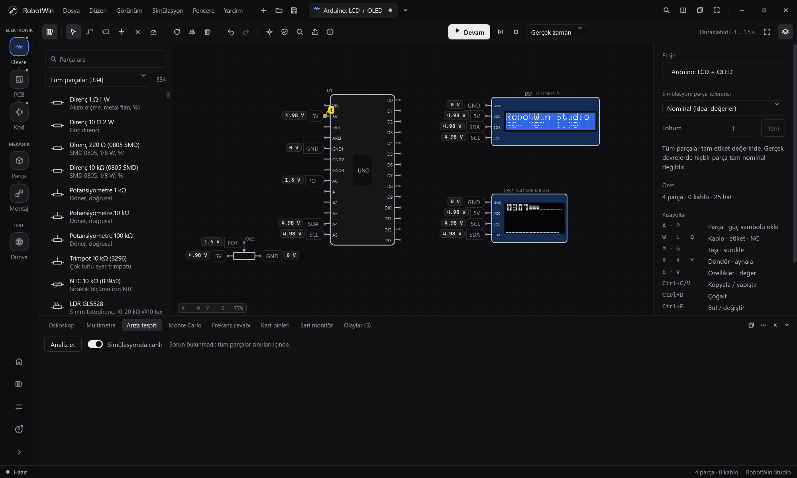

# 8. Ölçü aletleri

RobotWin Studio'daki ölçü aletleri gerçek cihazlar gibi davranır: osiloskobun probu devreye yük olur, multimetrenin sigortası atabilir, laboratuvar güç kaynağı akım sınırına girer. Aletlerin çoğu **Devre** sayfasının alt sekmelerindedir.

## Osiloskop

**Osiloskop** sekmesi 4 kanallı bir dijital osiloskoptur.

### Prob takma

1. Simülasyonu başlatın (F5).
2. Ölçmek istediğiniz kabloya tıklayın; prob ilk boş kanala takılır.
3. Belirli bir kanal için kabloya sağ tıklayıp **… → osiloskop CH1** … **CH4** seçin. Prob simülasyondan önce de takılabilir; simülasyon başlayınca ölçer.

### Ayarlar

| Bölüm | Ayarlar |
| --- | --- |
| Yatay | Zaman/div, konum, kayan (roll) mod |
| Kanal | Volt/div, konum, kuplaj (DC / AC / GND), prob 1× / 10×, 20 MHz bant sınırı, ters çevir, akım probu |
| Tetik | Mod (**Auto**, **Normal**, **Tek**), kaynak (1–4), eğim (yükselen / düşen), seviye, bekleme süresi |
| Matematik | 1+2 veya 1−2 |
| Düğmeler | **RUN / STOP**, **TEK**, **AUTOSET**, imleçler |

**Prob yüklemesi** açıkken prob devreye 1 MΩ ∥ 110 pF (1×) veya 10 MΩ ∥ 12 pF (10×) olarak bağlanır; yüksek empedanslı devrelerde ölçümün devreyi nasıl etkilediğini görürsünüz.

Otomatik ölçümler: tepe, dip, tepeden tepeye, genlik, ortalama, RMS, periyot, frekans, görev oranı, yükselme ve düşme süresi.

## Multimetre

**Multimetre** sekmesi 6000 sayımlı, true-RMS, otomatik kademeli bir el multimetresidir.

1. **Ölçü aleti** listesinden **Prob multimetre (kırmızı / siyah uçlar)** seçin.
2. Bir kabloya sağ tıklayıp **Multimetre kırmızı ucu → …** ve başka bir kabloya **Multimetre siyah ucu (COM) → …** seçin.
3. Döner anahtarla işlevi seçin: DC V, AC V, DC A, AC A, Ω, süreklilik (30 Ω altında öter), diyot, kapasite, frekans + görev oranı.

Dikkat edilecekler (gerçek multimetrede olduğu gibi):

- Akım ölçmek için multimetre devreye **seri** bağlanır. mA girişinde 440 mA, A girişinde 11 A sigorta vardır; aşırı akımda sigorta atar.
- Gerilim girişi devreye 10 MΩ yük olur.
- Enerjili devrede direnç ölçmeye çalışırsanız uyarı verir.

Multimetreyi devreye bir parça olarak da koyabilirsiniz: **Dijital Multimetre (6000 sayım)** veya **Multimetre (akım, mA girişi)**. Sonra **Ölçü aleti** listesinden bu parçayı seçin.

## Laboratuvar güç kaynağı

Kütüphanede **Lab. Güç Kaynağı 0-30 V 3 A** ve **Lab. Güç Kaynağı 5 V / 100 mA** bulunur.

- **CV / CC:** ayarlanan gerilimi verir; akım sınırına ulaşınca sabit akıma (CC) geçer. Kısa devrede devreniz yanmaz, kaynak CC'ye geçer.
- **OVP:** aşırı gerilim korumasıdır; tetiklenince çıkışı kapatır.
- Çıkış anahtarı vardır; kaynak akım çekemez (yalnızca verir).

Yeni bir devreyi ilk kez denerken **5 V / 100 mA** kaynağı kullanmak, hataların parça yakmasını önler.

## Ayarlanabilir AC/DC güç kaynağı

**Ayarlanabilir AC/DC Kaynak 0-30 V DC / 0-24 V AC, 3 A** üç çıkış tipinden birini verir. Tip, denetçideki **Çıkış tipi** ayarıyla seçilir:

| Çıkış | Ne verir |
| --- | --- |
| **DC** | Laboratuvar kaynağı gibi ayarlı gerilim (CV) ve akım sınırı (CC) |
| **AC** | Sinüs: **RMS gerilim**, **frekans** ve **faz** ayarlanır (tepe = √2 × RMS; 12 V~ için tepe 17 V) |
| **DC + AC** | DC geriliminin üstünde AC dalgalanma; doğrultulmuş beslemeyi ya da gürültülü bir hattı taklit eder |

- AC'de akım sınırı iki yönde de geçerlidir: kaynak akımı hem verir hem çeker ve tepe akımı sınırda tutar.
- **OVP**, gerilimin mutlak değerine bakar.
- Sembol ayarı gösterir, ör. `12V~` ya da `12+1~`. Devredeki gerilim göstergeleri AC hatlarda RMS değeri `V~` ile yazar; multimetrenin AC gerilim kademesi de gerçek RMS ölçer. Simülasyon raporu tam periyotlar üzerinden gerçek RMS gerilim ve akımı verir.

Hazır ayarlar: **AC Kaynak 12 V RMS 50 Hz** (trafo çıkışı; köprü doğrultucu ve kondansatör denemeleri), **AC Kaynak 24 V RMS 60 Hz** (endüstriyel kontrol gerilimi), **Şebeke 230 V RMS 50 Hz** (tepe 325 V) ve **DC 12 V + 1 V RMS dalgalanma 100 Hz** (regülatör ve filtre denemeleri).

## Toleranslar

Gerçek parçalar etiket değerlerinde değildir. Sağ paneldeki **Simülasyon: parça toleransı** seçeneği:

| Mod | Ne olur |
| --- | --- |
| **Nominal (ideal değerler)** | Tüm parçalar tam etiket değerinde |
| **Gerçekçi (sabit tohum)** | Her parça toleransı içinde sabit bir gerçek değer alır (direnç ±%5, seramik ±%10, elektrolitik −20/+80 %, hFE, LED Vf…). Aynı **Tohum** her zaman aynı kartı verir; **Yeni** başka bir kart çeker. |
| **Monte Carlo (N koşu)** | Dağılımı görmek için alttaki **Monte Carlo** sekmesini kullanın |

## Monte Carlo

**Monte Carlo** sekmesi devreyi N kez, her seferinde toleransları yeniden çekerek çalıştırır ve seçtiğiniz bir hattı ölçer.

1. Ölçülecek hattı ve ölçüyü seçin (son değer, ortalama, en büyük, en küçük, tepeden tepeye, RMS).
2. **Çalıştır**'a basın (**İptal** ile durdurun).
3. Sonuç bir histogram olarak görünür; en küçük ve en büyük değer ile hangi koşuda çıktıkları ve yayılım yazılır.

Monte Carlo sırasında kart yazılımı çalışmaz; analog devre incelenir.

## Arıza tespiti

**Arıza tespiti** sekmesi devrenizdeki tasarım hatalarını bulur.

- **Analiz et:** devreyi kurallara göre tarar: besleme kısa devresi, dirençsiz LED, ters LED, ters elektrolitik kondansatör, boşta kalan girişler, toprak eksikliği, pinden doğrudan motor sürme, geri dönüş (flyback) diyodu eksikliği, regülatör sorunları…
- **Simülasyonda canlı:** simülasyon sırasında parçaların sınır değerlerine ne kadar yaklaştığını, pilin aşırı yüklenip yüklenmediğini, güç kaynağının CC moduna girip girmediğini ve multimetre sigortasını izler.
- **Neden?:** yanan bir parçanın neden yandığını açıklar.

## Dünyada ölçüm

**Dünya** sayfasında:

- Alttaki **Kablolar ve ölçümler** sekmesi her kablonun akımını, gücünü ve yük yüzdesini gösterir.
- Kablo çekme aracında fare bir pinin üstündeyken pinin canlı gerilimi görünür.
- Seçili nesnenin denetçisinde **Canlı ölçüm** bölümü vardır.

## Kayıt

**Dosya → Simülasyon kaydını kaydet (.rwsim)…** ölçüm kanallarını, olayları ve seri çıktıyı projeyle birlikte saklar. Kaydı açınca dalga biçimleri osiloskopta, olaylar günlükte yeniden görünür.

---

[← Önceki: 7. Dünya](07-dunya.md) · [İçindekiler](README.md) · [Sonraki: 9. Klavye kısayolları →](09-kisayollar.md)
