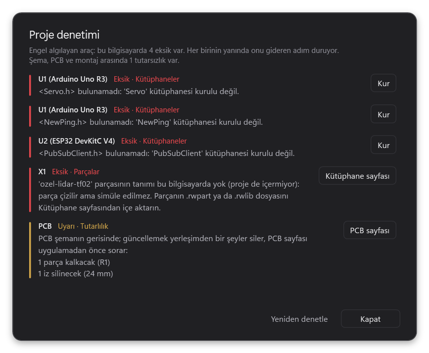
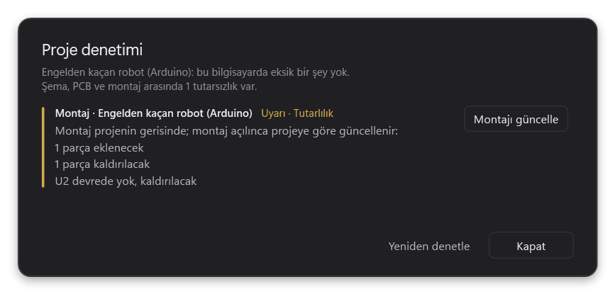
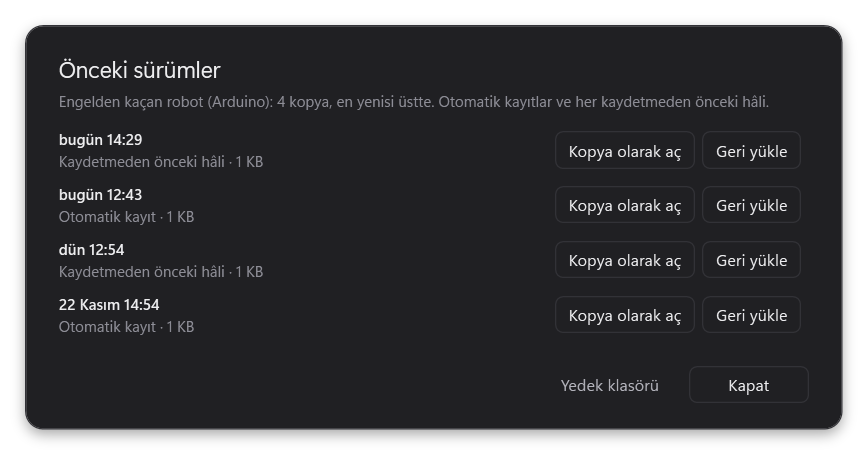

# 10. Sık sorulan sorular

## Kurulum ve açılış

**Uygulama açılmıyor veya .NET istiyor.**
Hafif kurulum bilgisayardaki .NET 9 Masaüstü Çalışma Zamanı'nı kullanır. Kurulum dosyasını yeniden çalıştırıp **Tam**'ı seçin (ya da **Özel** ile **.NET 9 çalışma zamanı** bileşenini ekleyin): uygulama o zaman kendi kopyasını taşır. Ya da Microsoft'un sitesinden ".NET 9 Desktop Runtime (x64)" kurun.

**Windows kurulum dosyası için uyarı veriyor.**
Dosyayı projenin GitHub Sürümler sayfasından indirdiğinizden emin olun, sonra **Ek bilgi → Yine de çalıştır** seçin.

**Uygulamayı USB bellekten çalıştırabilir miyim?**
Evet. Kurulum dosyasının "kurulum biçimi" sayfasında **Taşınabilir**'i ve bellekteki bir klasörü seçin (ya da `RobotWinStudio-Setup-<sürüm>.exe /S /PORTABLE /D=E:\RobotWin` çalıştırın); yalnızca dosyalar yazılır, kısayol ve kayıt defteri girdisi oluşturulmaz. Sürümdeki `-win-x64-portable.zip` aynı klasörün açılmaya hazır hâlidir.

**Arayüz çok küçük / çok büyük.**
**Görünüm → Arayüz ölçeği** ile %75–%150 arasında ayarlayın.

**Arayüz İngilizce olabilir mi?**
Evet: varsayılan dil İngilizcedir, Türkçe de arayüzün kendi dilidir. Dili kurulumun ilk sayfasında ya da **Ayarlar → Genel → Dil**'de seçin (uygulama yeniden açılınca her yerde geçerli olur). Başka bir dil için İngilizce paketi (`Lang/en.json`) örnek alıp kendi paketinizi `%APPDATA%\RobotWin\lang` klasörüne koyabilirsiniz. Belgeler Türkçe ve İngilizce eksiksiz ayrı ayrıdır.

**Başka bir bilgisayardan gelen proje açılınca "bu bilgisayarda … eksik var" diyor.**
Proje, bu bilgisayarda olmayan bir şeye ihtiyaç duyuyor: kodunu derleyecek Arduino derleyicisi (hafif kurulumda yoktur), ESP32 kodu için Visual Studio C++ araçları, kodun `#include` ettiği bir Arduino kütüphanesi ya da başka bir kütüphaneden gelen bir parçanın tanımı. **Göster** (ya da **Dosya → Projeyi denetle…**) her eksiği ve onu gideren adımı listeler: derleyiciyi kurulumun bileşeni olarak ekleme, kütüphaneyi tek tıkla kurma, parçayı Kütüphane sayfasından içe aktarma. Son derlemesiyle çalışabilen bir Uno kodu yalnız not olarak geçer.

**Proje denetimi "şema, PCB ve montaj arasında … tutarsızlık var" diyor.**
Şema, kartı ya da montajı geride bırakmış. Kart yerleşimden bir şey götürecek bir değişikliği bekliyorsa PCB sayfası onu uygulamadan önce sorar (**PCB sayfası** düğmesi oraya götürür). Montaj açılınca projesine göre güncellenir; denetim neyin değişeceğini önceden söyler (eklenecek ve kaldırılacak parçalar, hangileri) ve **Montajı güncelle** bunu hemen yapar. Montajın izlediği proje dosyası taşınmış ya da silinmişse onu da söyler.

**Bir dosyanın önceki hâline nasıl dönerim?**
**Dosya → Önceki sürümler…** açık belgenin yedek klasöründeki kopyalarını en yenisi üstte listeler: birkaç dakikada bir alınan otomatik kayıtlar ve her kaydetmeden önceki hâli. **Kopya olarak aç** o sürümü yanında yeni bir sekmede açar (karşılaştırmak ya da bir parçayı almak için), **Geri yükle** dosyayı o sürüme döndürür; şu anki hâli de önceki sürüm olarak saklandığından bu adım da aynı yoldan geri alınabilir. Kaç kopya tutulacağı ve klasörün boyutu **Ayarlar → Kaydetme ve yedekleme**'dedir.

## Kod ve derleme

**"arduino-cli bulunamadı" diyor.**
Bir terminalde `winget install ArduinoSA.CLI` ve ardından `arduino-cli core install arduino:avr` çalıştırın, sonra uygulamayı yeniden başlatın. Hâlâ bulamazsa **Ayarlar → Derleyiciler → arduino-cli yolu** alanına `arduino-cli.exe`'nin yolunu girin.

**"… bulunamadı (kütüphane kurulu değil)" diyor.**
Kodunuzun kullandığı Arduino kütüphanesi kurulu değil. Örneğin: `arduino-cli lib install "Adafruit SSD1306"`.

**ESP32 kodu derlenmiyor: "MSVC (vcvars64.bat) bulunamadı".**
Visual Studio 2022 veya Build Tools'u **"C++ ile masaüstü geliştirme"** iş yüküyle kurun. Farklı bir yere kurduysanız **Ayarlar → Derleyiciler → vcvars64.bat yolu** alanını doldurun.

**ESP32'nin ilk derlemesi çok uzun sürdü.**
Normal. İlk derlemede ESP32 donanım katmanı da derlenir ve önbelleğe alınır; sonraki derlemeler hızlıdır.

**ESP32 kodum İnternet'e bağlanamıyor.**
Wi-Fi yalnızca dünyanın içinde, kartlar arasında simüle edilir; gerçek İnternet bağlantısı yoktur.

**SPI ekranım / sensörüm çalışmıyor.**
SPI şu anda desteklenmiyor (yalnızca boş bir taklit var). I²C modüllerini kullanın: SSD1306 OLED, 16×2 / 20×4 LCD (PCF8574), MPU-6050.

## Simülasyon

**Bir parça yandı, devre artık çalışmıyor.**
Simülasyon gerçek hayattaki gibi parça hasarı hesaplar. **Arıza tespiti → Neden?** ile sebebini görün, devreyi düzeltin ve **Hasarlı parçaları onar**'a basın. Hasarı kapatmak isterseniz **Simülasyon → Parça hasarı (yanma, sigorta)** seçeneğini kapatın.

**Durum çubuğunda "gerçek zamanın %…'i" yazıyor.**
Bilgisayar simülasyona gerçek zamanda yetişemiyor. Hızı düşürün, **Ayarlar → 3D kalitesi**'ni azaltın veya kullanmadığınız sekmeleri kapatın. Sonuçlar yine doğrudur, yalnızca daha yavaş ilerler.

Neyin yavaşlattığını görmek için **Görünüm → Performans göstergesi**'ni (Ctrl+Shift+F) açın. Dünya çalışırken her çözücünün (devre, kart yazılımı, katı cisimler, sıvılar, kablolar, ısı…) simülasyon saniyesi başına kaç milisaniye harcadığı ve payı listelenir. Toplam bini geçerse dünya gerçek zamana yetişemez. Örneğin su bardağında payın çoğu sıvınındır; sıvının parçacık aralığını büyütmek onu hızlandırır.

**3B görünüm siyah kalıyor, titriyor ya da bozuk çiziliyor.**
3B görünümleri (dünya, oyun görünümü, modelleyici, kartın 3B görünümü, parça önizlemeleri) RobotWin'in kendi çizicisi ekran kartında çizer: gerçekçi malzemeler, güneşin yumuşak gölgesi, lambalar ve LED'ler piksel piksel aydınlatılır. Ekran kartı ya da sürücüsü sorun çıkarırsa **Ayarlar → Görünüm ve tema → 3B çizici → WPF** ile eski çizime dönün. Ekran kartı hiç kullanılamıyorsa uygulama kendiliğinden WPF'ye döner ve durum çubuğunda söyler.

**Dünyadaki kartım hiçbir şey yapmıyor.**
**Olaylar** sekmesinde "Yüklü yazılım yok (kart boşta)" yazıyorsa kartın kodu yoktur: kartı seçip **Kartın kodunu yaz** ile kod yazın. Ayrıca kartın beslendiğinden emin olun (pil kablosu veya **USB'yi tak**).

**İki kart arasındaki sinyal çalışmıyor.**
Dünyadaki kartlar, kabloyla bağlanana kadar elektriksel olarak ayrıdır. Sinyal kablosunun yanında GND'leri de birbirine bağlayın.

**Kablo "YANDI" oldu.**
Kablodan geçen akım kesitinin taşıyabileceğinden fazlaydı. Daha kalın bir kablo seçin (daha küçük AWG) veya akımı sınırlayın.

**Dünyada nesneyi sürükleyemiyorum.**
Nesneler yalnızca simülasyon dururken taşınabilir. **Durdur ve başa dön** (Shift+F5) ile durdurun.

**Kumandam görünmüyor.**
Kumandayı seçip **Kumandaları yeniden tara**'ya basın. Gerçek kumanda yoksa **Sanal kumandayı aç (fare / klavye)** ile ekrandaki kumandayı kullanın. Kumandanın ESP32 ile eşleştiğinden emin olun (**Eşleştirme modu**).

**Bir parça garip çarpışıyor ya da yuvarlanmıyor.**
**Görünüm → Çarpışma şekilleri (dünya)** fiziğin gerçekten kullandığı gövdeyi gösterir: parçanın kendi 3D modelinin dış hattı.

**Ses gelmiyor.**
**Simülasyon → Simülasyon sesleri** açık mı, **Ayarlar → Ses düzeyi** sıfır mı, kontrol edin.

## Dosyalar

**Kaydetmeyi unuttum, işim gitti mi?**
Uygulama işinizi belirli aralıklarla `Belgeler\RobotWin\Yedekler` klasörüne yedekler. **Başlangıç** sayfasındaki **Otomatik yedekler** listesine veya **Dosya → Otomatik yedekler klasörü**'ne bakın. Aralığı **Ayarlar → Dosyalar ve otomatik kayıt** bölümünden değiştirebilirsiniz.

**Dosyaya çift tıklayınca uygulama açılmıyor.**
**Ayarlar → Dosya türleri → Windows'ta bu uygulamayla aç** düğmesine basın.

**Projemi KiCad'de açabilir miyim?**
Evet. **PCB** sayfasında **KiCad'e aktar** bir KiCad 8 projesi oluşturur. Kart üreticisi için **Üretim** düğmesi Gerber dosyalarını verir. Ayrıntılar: [3. PCB](03-pcb.md).

**3D yazıcıda parça basmak istiyorum.**
Parçayı **Parça** sayfasında yapıp STL olarak dışa aktarın: [5. Parça](05-modelle.md).

## Hata bildirme

Bir hata bulduysanız **Yardım → Sorun bildir…** ile GitHub'da bir kayıt açın. Mümkünse adımları, ekran görüntüsünü ve `%APPDATA%\RobotWinStudio\crash.log` dosyasını ekleyin (**Ayarlar → Hakkında → Ayar ve günlük klasörünü aç**).

---

[← Önceki: 9. Klavye kısayolları](09-kisayollar.md) · [İçindekiler](README.md)
