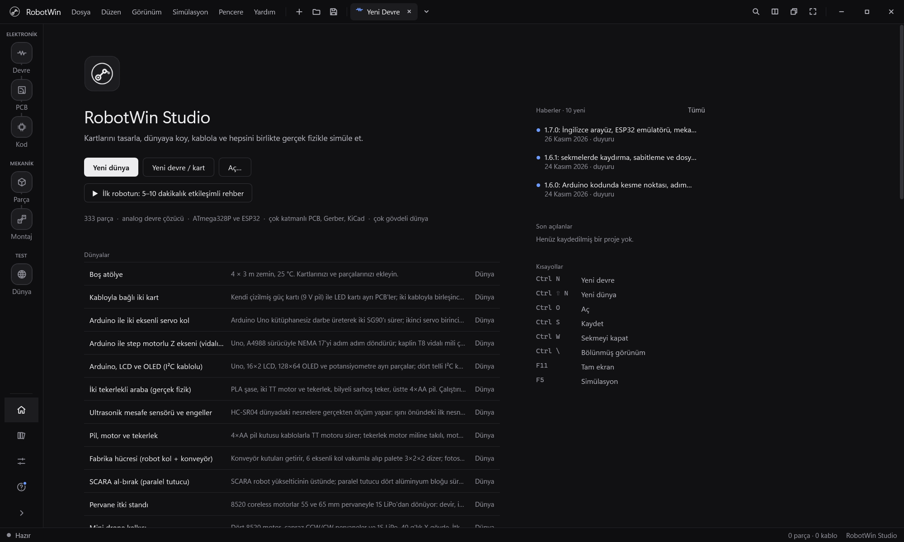
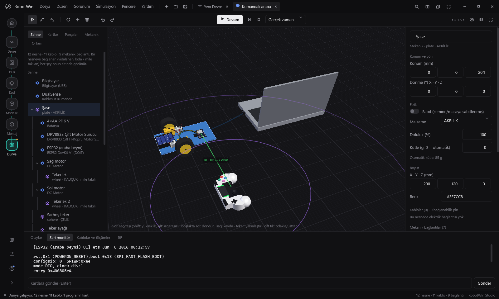

# RobotWin Studio kullanım kılavuzu

RobotWin Studio ile bir robot projesini baştan sona tek uygulamada yaparsınız: devreyi çizer, PCB'sini çıkarır, kodunu yazar, gövdesini modeller, sonra hepsini gerçek fizikli bir dünyada birlikte çalıştırırsınız.

Bu kılavuz uygulamayı adım adım anlatır. Sırayla okuyabilir ya da doğrudan ihtiyacınız olan bölüme geçebilirsiniz. Her çözücünün denklemleri [Fizik ve matematik](../fizik/README.md) bölümündedir.

## İçindekiler

| Bölüm | Konu |
| --- | --- |
| [1. Başlarken](01-baslarken.md) | Kurulum, ilk açılış, ekranın bölümleri, dosyalar, ayarlar |
| [2. Devre](02-devre.md) | Şema çizme, parça ekleme, kablolama, canlı simülasyon |
| [3. PCB](03-pcb.md) | Kart tasarımı, yol çizimi, bakır alanlar, DRC, üretim dosyaları |
| [4. Kod](04-kod.md) | Arduino ve ESP32 kodu yazma, derleme, karta yükleme, seri monitör |
| [5. Modelle](05-modelle.md) | 3D parça modelleme: şase, braket, kutu; dünyaya gönderme |
| [6. Montaj](06-montaj.md) | Devreyi gerçek bir montaja çevirmek: kart, gerçek parçalar, pin pin kablolar |
| [7. Dünya](07-dunya.md) | Açık dünya: kartlar, parçalar, kablolar, mekanik bağlantılar, fizik, kumandalar, basınçlı kaplar ve roketler |
| [8. Ölçü aletleri](08-olcu-aletleri.md) | Osiloskop, multimetre, laboratuvar güç kaynağı, toleranslar, Monte Carlo, arıza tespiti |
| [9. Klavye kısayolları](09-kisayollar.md) | Tüm sayfaların kısayolları |
| [10. Sık sorulan sorular](10-sss.md) | Sorunlar ve çözümleri |

## Beş dakikada ne yapabilirim?

1. Uygulamayı açın; **Başlangıç** sayfasında **Dünyalar** listesinden **Kumandalı araba (ESP32 + PS5 kumanda)** şablonunu seçin.
2. **F5** ile dünyayı çalıştırın.
3. Kumandayı seçip **Sanal kumandayı aç (fare / klavye)** ile arabayı sürün.

Ayrıntılar: [7. Dünya](07-dunya.md).

## Tasarımdan gerçeğe hattı

Ekranın solundaki dikey çizgi, bir projenin aşamalarını sırayla gösterir. Her aşamanın yanında o aşamanın durumu yazar. **Ctrl+B** hattı genişletir veya daraltır.

| Aşama | Kısayol | Kılavuz |
| --- | --- | --- |
| Başlangıç | Ctrl+0 | [1. Başlarken](01-baslarken.md) |
| Devre | Ctrl+1 | [2. Devre](02-devre.md) |
| PCB | Ctrl+2 | [3. PCB](03-pcb.md) |
| Kod | Ctrl+3 | [4. Kod](04-kod.md) |
| Modelle | Ctrl+4 | [5. Modelle](05-modelle.md) |
| Montaj | Ctrl+5 | [6. Montaj](06-montaj.md) |
| Dünya | Ctrl+6 | [7. Dünya](07-dunya.md) |
| Kütüphane | Ctrl+7 | [1. Başlarken](01-baslarken.md#kütüphane) |
| Ayarlar | Ctrl+, | [1. Başlarken](01-baslarken.md#ayarlar) |
